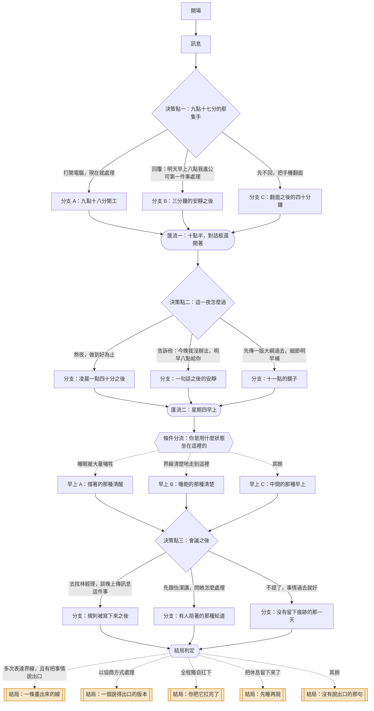

# 01｜《晚上九點十七分》

> 主管下班後傳訊　・　主題：工作責任與個人界線
>
> 泡麵還冒著熱氣，手機亮了。明天早上十點要用的簡報，現在要改。

<!-- 這份文件由 tools/build-scripts.mjs 從 content/stories/story_01_late_message.json 產生，請勿手動編輯。 -->

| 項目 | 內容 |
|---|---|
| story_id | `story_01_late_message` |
| 版本 | 1.0.0（schema 1.0.0） |
| 對應島嶼 | 界線島（`island_boundary`） |
| 預估時間 | 約 3 分鐘 |
| 節點 / 決策點 / 選項 | 26 / 3 / 9 |
| 固定結局 / 航線 | 5 / 3 |
| 內容提醒 | 職場壓力、加班、界線議題 |

## 場景與情緒衝突

- **地點**：你的租屋處，六坪大的套房，桌上一碗剛泡好的麵
- **時間**：星期三晚上九點十七分
- **衝突**：責任感說「現在就做」，身體說「我今天已經結束了」。兩個聲音都是你。

## 人物

| 角色 | 身分 | 設定 | 說話方式 |
|---|---|---|---|
| 你 | 專案執行 | 進公司一年八個月。做事細、交件準時，所以大家都知道傳給你一定會動。 | 心裡話很多，說出口的很少 |
| 林經理 | 直屬主管 | 四十多歲，兩個小孩。自己也常常半夜在回信，並不覺得這有什麼問題。 | 客氣、句尾常加『好嗎』『麻煩你』，但訊息一則接一則 |
| 怡潔 | 同組同事 | 比你早兩年進來。手機工作群組常年靜音，從來沒有人說過她什麼。 | 直接、省話，偶爾一句很準 |

## 狀態變數

航線判定只讀這些變數與選項標記，不讀其他任何東西。

| key | 名稱 | 初始值 | 說明 |
|---|---|---|---|
| `boundary` | 界線 | 0 | 你把「可以」與「不行」說出口的程度 |
| `care` | 自我照顧 | 0 | 你有沒有留下屬於自己的時間與睡眠 |
| `duty` | 承擔 | 0 | 你實際扛下了多少工作 |
| `voice` | 開口 | 0 | 你把狀況說給別人聽的程度 |

## 流程圖

## 完整劇本

### 開場

`n_01_open`　・　旁白

*租屋處　・　星期三 21:17　・　剛要落地的疲倦*

> 你洗完澡，頭髮還半濕。泡麵悶了三分鐘，剛剛好。
>
> 影片按下播放，你把腳縮上椅子——這是今天第一個完全屬於你的動作。
>
> **音效**（音效）：手機在桌面上亮起來，嗡了一聲。
>
> 螢幕上是四個字：林經理。

**前往**：`n_01_message`

### 訊息

`n_01_message`　・　旁白

*租屋處　・　星期三 21:17　・　胃往下沉*

> **林經理**（訊息）：不好意思這麼晚打擾～客戶臨時把會議提前到明天早上十點
>
> **林經理**（訊息）：簡報第三到第五頁要照新的方向重做，你方便看一下嗎？
>
> **內心**（心聲）：麵還在冒煙。你看著那兩行字，看了大概十秒。

**前往**：`n_01_d1`

### 決策點一：九點十七分的那隻手

`n_01_d1`　・　決策點

*租屋處　・　星期三 21:18　・　手指懸在螢幕上方*

> 你的手指懸在螢幕上方。

#### 選項：打開電腦，現在就處理

`c_01_d1_now`　・　副標：「先把事情解決，心才放得下來」

**立即反應**

> 你把筆電掀開。開機的風扇聲，和影片的聲音疊在一起，你伸手把影片關掉。
>
> **你**（訊息）：好的，我現在看一下
>
> **林經理**（訊息）：太好了，麻煩你囉🙏
>
> 麵在旁邊，慢慢變成一碗冷掉的、糊掉的東西。

**實際後果**：你在九點十八分重新上工，今晚不再屬於你。

**心聲線索「心聲線索」**（`clue_01_fast_yes`）

> 你回得很快。快到你自己都還沒問過：我現在想做這件事嗎？「立刻答應」有時候不是因為願意，是因為那樣最不用面對對方的反應。

**狀態影響**：承擔 +2、自我照顧 -1　|　**標記**：`take_on`　|　**前往**：`n_01_a1`

#### 選項：回覆：明天早上八點我進公司第一件事處理

`c_01_d1_tomorrow`　・　副標：「不是拒絕，是把它放回上班時間」

**立即反應**

> **你**（訊息）：經理，我明天早上八點到公司，第一件事就處理，十點前一定給你
>
> 你按下送出。訊息旁邊的「已讀」亮起來。
>
> 然後，沒有了。三分鐘，對話框安安靜靜。
>
> **內心**（心聲）：你發現自己一直盯著那三個字看。已讀。然後呢。

**實際後果**：你把時間劃回上班時段，也把一段不確定留給了自己。

**心聲線索「心聲線索」**（`clue_01_name_the_time`）

> 你給了一個具體時間，而不是一句「不行」。這通常比較容易被接受，但你也付出了代價——接下來那三分鐘的安靜，是你自己在撐。

**狀態影響**：界線 +2、開口 +1　|　**標記**：`boundary_clear`、`speak`　|　**前往**：`n_01_b1`

#### 選項：先不回，把手機翻面

`c_01_d1_pause`　・　副標：「今天到此為止，明天的事明天再說」

**立即反應**

> 你把手機蓋在桌上，螢幕朝下。影片繼續播。
>
> 十分鐘後你發現，剛剛那一段你一句都沒聽進去。
>
> **內心**（心聲）：人在這裡，腦子在那則訊息裡。

**實際後果**：你沒有回，但那則訊息整個晚上都在房間裡。

**心聲線索「心聲線索」**（`clue_01_face_down`）

> 把手機翻面，是身體先替你做的決定。它在說：我今天已經結束了。只是「不回」還不等於「放下」——沒說出口的那部分，常常由你自己扛著。

**狀態影響**：自我照顧 +2、界線 +1　|　**標記**：`pause`　|　**前往**：`n_01_c1`

### 分支 A：九點十八分開工

`n_01_a1`　・　旁白

*租屋處書桌　・　星期三 22:05　・　進入狀態，但不是自己想進的那種*

> 第三頁改完，十點零五分。第四頁的圖表要重拉，你找不到原始檔。
>
> **林經理**（訊息）：辛苦了！啊對，順便第七頁的數字也更新一下好嗎
>
> **內心**（心聲）：第七頁。剛剛說的是第三到第五頁。
>
> 你沒有說什麼。你把第七頁打開。

**前往**：`n_01_merge1`

### 分支 B：三分鐘的安靜之後

`n_01_b1`　・　旁白

*租屋處　・　星期三 21:24　・　等待*

> **林經理**（訊息）：明天十點就要用，八點會不會有點趕？
>
> **林經理**（訊息）：我是怕來不及啦，你評估看看
>
> 「你評估看看」——這句話把球丟回來了，而且丟得很輕，輕到你很難不接。
>
> **內心**（心聲）：他沒有命令你。他只是擔心。所以如果事情沒做好，就是你的評估有問題。

**前往**：`n_01_merge1`

### 分支 C：翻面之後的四十分鐘

`n_01_c1`　・　旁白

*租屋處　・　星期三 22:01　・　心不在焉*

> 四十分鐘後，你翻回手機。兩則新訊息。
>
> **林經理**（訊息）：在嗎？
>
> **林經理**（訊息）：如果今天真的不方便，我再問問怡潔
>
> **內心**（心聲）：最後那句，你讀了兩次。
>
> 它聽起來很體貼。它也剛好讓你知道：有人可以取代你。

**前往**：`n_01_merge1`

### 匯流一：十點半，對話框還開著

`n_01_merge1`　・　匯流　・　承接：`n_01_a1`、`n_01_b1`、`n_01_c1`

*租屋處　・　星期三 22:30　・　今晚不會自己結束*

> 十點半。不管你剛剛怎麼做，有一件事沒有變——
>
> 明天早上十點，那份簡報要上場。而現在，它還不是能上場的樣子。

**條件式對白**　若：標記「take_on」次數 >= 1

> 你已經做了一個半小時。眼睛開始酸，第四頁才做到一半。

**條件式對白**　若：標記「boundary_clear」次數 >= 1

> 你還沒動手。但你也還沒真的放下——你在想明天八點到十點，夠不夠。

**條件式對白**　若：標記「pause」次數 >= 1

> 你一個字都還沒回。手機在手上，螢幕的光打在你臉上。

**前往**：`n_01_d2`

### 決策點二：這一夜怎麼過

`n_01_d2`　・　決策點

*租屋處　・　星期三 22:31　・　要為整個晚上做一個決定*

> 你看了一眼時間，再看一眼明天的行程。

#### 選項：熬夜，做到好為止

`c_01_d2_allnight`　・　副標：「做完才睡得著」

**立即反應**

> 一點四十分，你存檔。第三到第五頁，還有第七頁，全部重做完。
>
> **你**（訊息）：經理，都改好了，檔案放雲端
>
> **林經理**（訊息）：👍
>
> 一個讚。你盯著那個圖示看了一下，然後把筆電闔上。

**實際後果**：你用自己的睡眠把事情補起來，沒有人知道這件事花了你多少。

**心聲線索「心聲線索」**（`clue_01_invisible_cost`）

> 你把缺口補起來了，而且補得很好——好到從外面完全看不出有過缺口。這是很多人累垮的方式：成本全部由你一個人默默吸收，於是下一次，標準就從這裡開始算。

**狀態影響**：承擔 +2、自我照顧 -2　|　**標記**：`take_on`　|　**前往**：`n_01_a2`

#### 選項：告訴他：今晚我沒辦法，明早八點給你

`c_01_d2_say_no`　・　副標：「把今晚還給自己」

**立即反應**

> **你**（訊息）：經理，今晚我沒辦法處理。我明早八點進公司做，十點前給你。
>
> 你看著那行字，手指在送出鍵上停了兩秒，然後按下去。
>
> 心跳有點快。這種快，和熬夜的快不太一樣。
>
> **林經理**（訊息）：好，那就辛苦你明天早一點
>
> **內心**（心聲）：⋯⋯就這樣？

**實際後果**：你把「今晚不行」說出口了，而天沒有塌下來。

**心聲線索「心聲線索」**（`clue_01_sky_didnt_fall`）

> 說出「今晚我沒辦法」之後，你心裡最大的那個預期——對方會生氣、會失望、會記住——有沒有真的發生？很多界線之所以難畫，不是因為對方不同意，是因為我們先在腦中演過一次最壞的版本。

**狀態影響**：界線 +2、開口 +1　|　**標記**：`boundary_clear`、`speak`　|　**前往**：`n_01_b2`

#### 選項：先傳一版大綱過去，細節明早補

`c_01_d2_partial`　・　副標：「給出一半，留下一半」

**立即反應**

> 你花二十五分鐘，把新方向的架構列成三頁純文字，沒有排版、沒有配圖。
>
> **你**（訊息）：經理，新方向的架構先給你，你看方向對不對。排版和圖我明早八點來做，十點前完成。
>
> **林經理**（訊息）：喔喔這樣很清楚，方向就這樣，明天再美化就好
>
> 十一點，你刷牙。鏡子裡的人看起來還行。

**實際後果**：你讓這件事變成一件可以討論的事，而不是一個必須獨自完成的指令。

**心聲線索「心聲線索」**（`clue_01_half_now`）

> 你沒有全收，也沒有全擋，你把事情切開了。這需要你先知道「哪一半現在真的需要」——這是一種很花腦力的體貼，記得它也是工作量。

**狀態影響**：開口 +2、承擔 +1、界線 +1　|　**標記**：`negotiate`、`speak`　|　**前往**：`n_01_c2`

### 分支：凌晨一點四十分之後

`n_01_a2`　・　旁白

*床上　・　凌晨 01:52　・　過度清醒*

> 躺下之後，腦子還在跑第四頁的圖表。你翻了三次身。
>
> 最後一次看時間是兩點二十。鬧鐘設在六點五十。

**前往**：`n_01_merge2`

### 分支：一句話之後的安靜

`n_01_b2`　・　旁白

*床上　・　星期三 23:10　・　鬆了一點，又還沒完全鬆*

> 你十一點十分上床。難得的早。
>
> **內心**（心聲）：但你還是想了一下：他那句『那就辛苦你明天早一點』，到底是不是在不高興。
>
> 想著想著，你睡著了。

**前往**：`n_01_merge2`

### 分支：十一點的鏡子

`n_01_c2`　・　旁白

*浴室／床上　・　星期三 23:00　・　事情還在，但今晚結束了*

> 你設了兩個鬧鐘，六點四十、六點五十。
>
> 事情還沒做完，但你知道明天早上那兩個小時要做什麼。這種「知道」，讓人睡得著。

**前往**：`n_01_merge2`

### 匯流二：星期四早上

`n_01_merge2`　・　匯流　・　承接：`n_01_a2`、`n_01_b2`、`n_01_c2`

*公司　・　星期四 09:58　・　會議前兩分鐘*

> 九點五十八分，會議室。投影機嗡嗡作響。
>
> 簡報順利跑完。客戶點頭，說第四頁的圖很清楚。
>
> **林經理**：這是我們團隊昨天晚上趕出來的，謝謝大家配合。

**前往**：`n_01_morning_check`

### 條件分流：你是用什麼狀態坐在這裡的

`n_01_morning_check`　・　條件分流

| 順序 | 條件 | 前往 | 說明 |
|---|---|---|---|
| 1 | 自我照顧 <= -2 | `n_01_m_tired` | 睡眠被大量犧牲 |
| 2 | 界線 >= 3 | `n_01_m_steady` | 界線清楚地走到這裡 |
| 保底 | 以上皆不成立 | `n_01_m_middle` | — |

### 早上 A：撐著的那種清醒

`n_01_m_tired`　・　旁白

*會議室　・　星期四 10:40　・　亢奮之後的空*

> 你聽見「昨天晚上趕出來的」，身體有一瞬間的反應——不是生氣，比較像有什麼東西悶住了。
>
> 散會後怡潔走過來，手上兩杯咖啡，遞給你一杯。
>
> **怡潔**：你昨天幾點睡？
>
> **怡潔**：你的黑眼圈在跟我講話。

**前往**：`n_01_d3`

### 早上 B：睡飽的那種清楚

`n_01_m_steady`　・　旁白

*會議室　・　星期四 10:40　・　腳踏在地上*

> 你聽見「昨天晚上趕出來的」，心裡清楚地知道：昨天晚上，你在家裡。
>
> 那句話沒有騙人，只是也沒有那麼準。
>
> 散會後怡潔走過來，遞給你一杯咖啡。
>
> **怡潔**：昨天經理也傳給我了。我十一點才看到，就沒回。
>
> **怡潔**：他今天也沒說什麼啊。

**前往**：`n_01_d3`

### 早上 C：中間的那種早上

`n_01_m_middle`　・　旁白

*會議室　・　星期四 10:40　・　還好，但說不上好*

> 會議結束，客戶滿意。你收起筆電，動作比平常慢一點。
>
> 怡潔走過來，遞給你一杯咖啡。
>
> **怡潔**：昨天那個急件，他幾點傳給你的？
>
> **怡潔**：我是問一下而已。我每次都裝沒看到。

**前往**：`n_01_d3`

### 決策點三：會議之後

`n_01_d3`　・　決策點

*茶水間　・　星期四 10:45　・　一個可以說話的空檔*

> 茶水間只有你們兩個。林經理的辦公室就在走廊另一頭，門開著。

#### 選項：去找林經理，談晚上傳訊息這件事

`c_01_d3_talk`　・　副標：「把這件事放到桌面上」

**立即反應**

> 你敲了門。林經理抬頭，示意你坐。
>
> **你**：經理，昨天的案子有趕上，我想跟你討論一下下班之後的訊息。
>
> **你**：我晚上九點之後通常不會開電腦。如果是隔天早上要用的，可以在下班前跟我說嗎？真的臨時的，我們約一個做法。
>
> 林經理愣了一下。那一下有點長。
>
> **林經理**：⋯⋯喔。我沒想過這個。我自己都半夜在弄，就以為大家都一樣。
>
> **林經理**：那這樣好了，真的急的我打電話，其他的我標個『不急』。

**實際後果**：你把一次性的忍耐，換成了一條兩個人都看得到的規則。

**心聲線索「心聲線索」**（`clue_01_rule_not_mood`）

> 你談的不是「昨天那件事」，是「以後這類事情怎麼辦」。前者容易變成誰對誰錯，後者是在建立一個規則。多數人卡住的地方是：以為要先生氣，才有資格開口。

**狀態影響**：界線 +2、開口 +2　|　**標記**：`boundary_clear`、`speak`、`negotiate`　|　**前往**：`n_01_a3`

#### 選項：先跟怡潔講，問她怎麼處理

`c_01_d3_peer`　・　副標：「找一個懂的人說說」

**立即反應**

> **你**：九點十七分傳的。我⋯⋯其實有點不知道怎麼辦。
>
> **怡潔**：九點十七，真的假的。
>
> **怡潔**：我跟你說，我前兩年也每則都回。後來有一次我重感冒沒回，結果什麼事都沒發生。
>
> **怡潔**：他不是壞人啦，他只是沒在管時間。你不講，他就不會知道。
>
> 你笑了一下。原來不是只有你。

**實際後果**：你知道了這不是你一個人的問題，但規則還沒有改變。

**心聲線索「心聲線索」**（`clue_01_not_alone`）

> 「原來不是只有我」——這句話本身就有效果。被理解會讓事情變得比較可以承受。它和「事情被改變」是兩件事，兩件都需要，只是順序可以由你決定。

**狀態影響**：開口 +1、自我照顧 +1　|　**標記**：`seek_support`　|　**前往**：`n_01_b3`

#### 選項：不提了，事情過去就好

`c_01_d3_silent`　・　副標：「這次也撐過來了」

**立即反應**

> **你**：還好啦，沒什麼。
>
> 怡潔看了你一眼，沒有追問，點點頭就走了。
>
> 你把咖啡喝完。杯底有點甜。
>
> **內心**（心聲）：反正做完了。下次再說。

**實際後果**：這件事沒有留下任何紀錄，包括在林經理那裡。

**心聲線索「心聲線索」**（`clue_01_next_time`）

> 「下次再說」是很合理的選擇——你累了，而且事情真的過去了。只是有一件事值得記得：如果這次沒有留下痕跡，對方那邊的預設值，就會停在「這樣是可以的」。

**狀態影響**：承擔 +1　|　**標記**：`swallow`　|　**前往**：`n_01_c3`

### 分支：規則被寫下來之後

`n_01_a3`　・　旁白

*座位　・　星期四 11:20　・　一種陌生的輕*

> 下午，群組裡多了一則公告。
>
> **林經理**（訊息）：各位，以後下班後的訊息，如果我沒有特別註明【急】，都可以隔天上班再處理。真的很急我會打電話。
>
> 下面跳出三個讚，一個愛心。怡潔傳了一個貼圖給你，是一隻貓舉牌：恭喜。

**前往**：`n_01_ending_check`

### 分支：有人陪著的那種知道

`n_01_b3`　・　旁白

*座位　・　星期四 11:20　・　沒解決，但沒那麼重*

> 回到座位，你把手機的工作群組通知改成靜音。
>
> 只是靜音，沒有退出，也沒有跟誰說。
>
> **內心**（心聲）：這是一個很小的動作。小到沒有人會注意到。

**前往**：`n_01_ending_check`

### 分支：沒有留下痕跡的那一天

`n_01_c3`　・　旁白

*座位　・　星期四 11:20　・　平靜*

> 下午的工作很順。你把昨天沒吃的那碗麵倒掉，洗了碗。
>
> 一切回到原來的樣子。

**前往**：`n_01_ending_check`

### 結局判定

`n_01_ending_check`　・　條件分流

| 順序 | 條件 | 前往 | 說明 |
|---|---|---|---|
| 1 | 界線 >= 5 且 開口 >= 3 | `n_01_e_line` | 多次表達界線，且有把事情說出口 |
| 2 | 標記「negotiate」次數 >= 2 或 開口 >= 3 且 界線 >= 2 | `n_01_e_deal` | 以協商方式處理 |
| 3 | 標記「take_on」次數 >= 2 且 自我照顧 <= -1 | `n_01_e_carry` | 全程獨自扛下 |
| 4 | 自我照顧 >= 2 且 界線 >= 2 | `n_01_e_rest` | 把休息留下來了 |
| 保底 | 以上皆不成立 | `n_01_e_quiet` | — |

## 結局

### 一條畫出來的線

`e_01_line`　・　節點 `n_01_e_line`　・　標籤：`boundary`、`spoken`

> 星期五晚上九點十七分，手機沒有亮。
>
> 你注意到了這件事，這表示你其實一直在等它亮。
>
> 泡麵悶三分鐘，剛剛好。這次你把整集看完了。

**結局回顧**：這一次，你把「可以」和「不行」都說出口了。

> 界線不是一次畫完的。它是每一次你開口之後，才慢慢變成真的。

### 一個說得出口的版本

`e_01_deal`　・　節點 `n_01_e_deal`　・　標籤：`negotiate`、`spoken`

> 後來你發現，你和林經理之間多了一種講法：「這個我今天可以做到這裡，剩下的明天早上。」
>
> 不是每次都順利。但至少，它變成了一件可以談的事。

**結局回顧**：這一次，你沒有全部收下，也沒有一口回絕。

> 能切開的事情，就不必整塊吞下去。「我可以做到這裡」也是一種完整的回答。

### 你把它扛完了

`e_01_carry`　・　節點 `n_01_e_carry`　・　標籤：`carry`、`invisible_cost`

> 星期五，林經理在群組裡說：這週辛苦了，大家週末好好休息。
>
> 你看著那句話，想起星期三晚上那碗沒吃的麵。
>
> 沒有人做錯什麼。事情都完成了。你只是有點說不上來的累。

**結局回顧**：這一次，你用自己的時間和睡眠，把缺口補起來了。

> 你確實把事情做完了，這是真的。只是補缺口的成本，目前只有你自己知道——這件事也是真的。

### 先睡再說

`e_01_rest`　・　節點 `n_01_e_rest`　・　標籤：`self_care`、`boundary`

> 那天晚上你睡了七個半小時。
>
> 事情沒有全部解決，有些話也還沒說出口。但你是用一個睡飽的身體，去面對星期四的。
>
> 這件事沒有出現在任何一份工作報告裡。

**結局回顧**：這一次，你把休息留給了自己。

> 休息不需要先做完所有事才配擁有。你先把自己接住了，這不是逃避，是補給。

### 沒有說出口的那句

`e_01_quiet`　・　節點 `n_01_e_quiet`　・　標籤：`silent`、`pending`

> 一切回到原來的樣子。沒有人不開心，沒有事情出錯。
>
> 只有一句話留在你身上，它一直沒有找到可以說出口的地方。
>
> 下個星期三晚上九點十七分，手機又亮了。

**結局回顧**：這一次，有些話你留在心裡了。

> 留在心裡不等於做錯。只是那句話還在，它會等下一個九點十七分。你隨時可以回來，換一個方式走走看。

## 結局判定

| 順序 | 條件 | 結局 |
|---|---|---|
| 1 | 界線 >= 5 且 開口 >= 3 | 結局：一條畫出來的線 |
| 2 | 標記「negotiate」次數 >= 2 或 開口 >= 3 且 界線 >= 2 | 結局：一個說得出口的版本 |
| 3 | 標記「take_on」次數 >= 2 且 自我照顧 <= -1 | 結局：你把它扛完了 |
| 4 | 自我照顧 >= 2 且 界線 >= 2 | 結局：先睡再說 |
| 保底 | 以上皆不成立 | 結局：沒有說出口的那句 |

## 三條航線

航線由固定規則判定，依 priority 由小到大評估，第一個命中的即為結果；最後一條是保底規則，
所以任何遊玩組合都會落在恰好一條航線上。AI 不參與這個判定。

### 1. 立界線航線

`r_01_boundary`

**敘事意涵**：在故事中至少兩次主動把『可以』與『不行』說出口，或界線值累積到高點。重點不是拒絕，而是讓對方知道你的時間長什麼樣子。

**判定規則**：界線 >= 5 或 標記「boundary_clear」次數 >= 2

**航線解析（玩家看到的文案）**

> 你走的是「立界線航線」。
>
> 這條航線的特徵不是強硬，是具體：你給出了時間、範圍，或是一條以後大家都能照著走的規則。
>
> 畫界線最難的部分通常不在對方，而在按下送出之前的那兩秒。這次你按下去了。

**情緒練習卡**：《一句話的界線》把「不行」換成「我可以到這裡」（`pc_01_boundary`，約 2 分鐘）

**島嶼地景**：界線石徑　——　一條用石頭鋪出來的小路，從屋子一直走到島的邊緣。走到底會看到海。

> 島上多了一條石徑。它沒有通往任何地方，只是清楚地標示出：這裡是邊界。

新增地塊 1 個、新增物件 2 個。

### 2. 協商航線

`r_01_dialogue`

**敘事意涵**：沒有全部收下，也沒有一口回絕，而是把事情切開、說明、或找人討論。重點是讓事情從『獨自承擔的指令』變成『可以談的事』。

**判定規則**：標記「negotiate」次數 >= 1 或 開口 >= 3 或 標記「speak」次數 >= 2 或 標記「seek_support」次數 >= 1

**航線解析（玩家看到的文案）**

> 你走的是「協商航線」。
>
> 你沒有把事情整塊吞下去，也沒有把門關上，而是試著找出一個雙方都活得下去的版本。
>
> 這種做法很花腦力——你得先判斷哪一半現在真的需要。這份判斷本身就是工作量，值得被你自己看見。

**情緒練習卡**：《切一刀》哪一半現在真的需要？（`pc_01_dialogue`，約 3 分鐘）

**島嶼地景**：兩岸木橋　——　一座把兩塊地連起來的木橋。本來隔著水的地方，現在走得過去了。

> 島的另一邊浮出一塊地，中間架起一座木橋。走過去要花一點時間，但它通了。

新增地塊 1 個、新增物件 1 個。

### 3. 接住航線

`r_01_carry`

**敘事意涵**：保底航線。以承擔、沉默或獨自完成為主的所有組合都落在這裡。不代表做錯，代表這一次成本主要由你吸收。

**判定規則**：永遠成立（保底）

**航線解析（玩家看到的文案）**

> 你走的是「接住航線」。
>
> 事情沒有掉下來，因為你在下面接著。這份可靠是真的，完成度也是真的。
>
> 唯一沒有被記錄下來的，是接住它花了你多少——那個部分目前只有你自己知道。知道，是改變的第一步。

**情緒練習卡**：《記一筆帳》給那些沒有人看見的時間（`pc_01_carry`，約 2 分鐘）

**島嶼地景**：夜間的燈　——　屋子旁邊亮起一盞燈。不管多晚回來，它都還亮著。

> 屋子旁邊多了一盞燈，和一張面向海的長椅。給那些很晚才結束的日子。

新增地塊 1 個、新增物件 2 個。

## 重新遊玩可以探索的

- 第一個決策點如果換一個做法，林經理在十點之後傳來的訊息會完全不同。
- 星期四早上的場景有三個版本，取決於你前一晚睡了多久、以及有沒有把話說出口。
- 怡潔在茶水間說的話，會隨著你走過來的路徑而改變——她不是每次都說同一句。
- 這篇故事有五個固定結局與三條航線，其中「先睡再說」只有在你兩次都把時間留給自己時才會出現。

