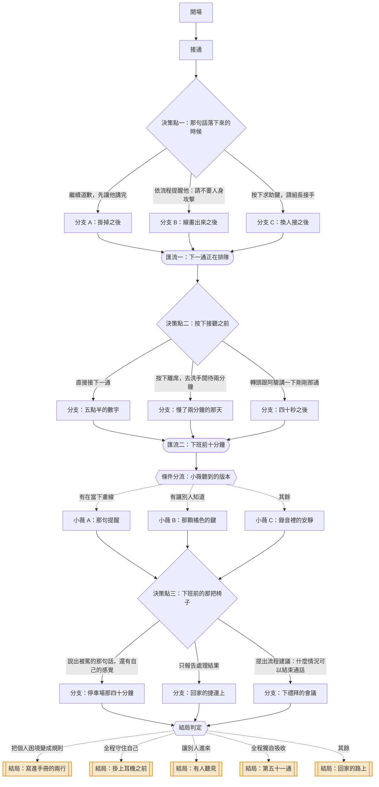

# 02｜《第四十七通電話》

> 客服面對情緒激動的顧客　・　主題：委屈與自我保護
>
> 離下班還有一小時十分。這是今天第四十七通，而他第一句話就不是在講訂單。

<!-- 這份文件由 tools/build-scripts.mjs 從 content/stories/story_02_forty_seventh_call.json 產生，請勿手動編輯。 -->

| 項目 | 內容 |
|---|---|
| story_id | `story_02_forty_seventh_call` |
| 版本 | 1.0.0（schema 1.0.0） |
| 對應島嶼 | 回聲島（`island_voice`） |
| 預估時間 | 約 3 分鐘 |
| 節點 / 決策點 / 選項 | 26 / 3 / 9 |
| 固定結局 / 航線 | 5 / 3 |
| 內容提醒 | 言語攻擊、情緒勞動、客服現場 |

## 場景與情緒衝突

- **地點**：電商客服中心，四十幾個座位，牆上的看板亮著即時數字
- **時間**：星期二下午 16:50
- **衝突**：被攻擊的是你這個人，但公司給的流程只處理訂單。中間那段，沒有人接手。

## 人物

| 角色 | 身分 | 設定 | 說話方式 |
|---|---|---|---|
| 你 | 客服專員 | 做這份工作一年三個月。耳機戴久了，耳朵上方會有一條壓痕。 | 語速穩、咬字清楚，那是訓練出來的 |
| 陳先生 | 顧客 | 訂單延誤第四天。前面已經打過兩通，每一通都要從頭講一次。 | 越講越快，音量一階一階往上 |
| 小薇 | 客服組長 | 自己也從線上做起來的。看板上的數字壓在她身上，也壓在你身上。 | 溫和但直接，習慣先問數字再問人 |
| 阿駿 | 鄰座同事 | 比你晚進來三個月。遇到難搞的電話會把耳機拉下來一點，深呼吸再戴回去。 | 句子短，常常只有一個「欸」 |

## 狀態變數

航線判定只讀這些變數與選項標記，不讀其他任何東西。

| key | 名稱 | 初始值 | 說明 |
|---|---|---|---|
| `protect` | 自我保護 | 0 | 你在當下為自己留下的空間 |
| `endure` | 承受 | 0 | 你獨自吞下的部分 |
| `support` | 連結 | 0 | 你讓別人知道、或請人接手的程度 |
| `voice` | 開口 | 0 | 你把事情說出來、說清楚的程度 |

## 流程圖

## 完整劇本

### 開場

`n_02_open`　・　旁白

*客服中心　・　星期二 16:50　・　一天快要撐完的那種平靜*

> 牆上的看板亮著：等待中 12 通，平均等待 4 分 32 秒。
>
> 你喝了一口已經涼掉的水。今天的第四十七通，系統正在接通。
>
> **音效**（音效）：嘟——

**前往**：`n_02_call`

### 接通

`n_02_call`　・　旁白

*客服中心　・　星期二 16:51　・　照著腳本開始*

> **你**：您好，很高興為您服務，請問有什麼可以幫您——
>
> **陳先生**：你們到底是在幹嘛？四天了！第四天了你知道嗎！
>
> **你**：陳先生您好，非常抱歉造成您的不便，我馬上幫您查訂單狀態——
>
> **陳先生**：每次都說馬上！上一個也說馬上！
>
> 你一邊聽，一邊把訂單調出來。物流端卡住，第四天，系統顯示「調查中」。
>
> **陳先生**：你們這種公司是怎麼活下來的？你是新來的喔？這麼簡單的事都處理不好，你是不是腦袋有問題？
>
> 最後那句，和前面不一樣了。
>
> **內心**（心聲）：前面那些是在罵事情。這一句，是在罵你。

**前往**：`n_02_d1`

### 決策點一：那句話落下來的時候

`n_02_d1`　・　決策點

*客服中心　・　星期二 16:54　・　胸口一緊*

> 鍵盤的手停了一下。桌上有一張貼紙，是公司發的：「微笑，客戶聽得見。」

#### 選項：繼續道歉，先讓他講完

`c_02_d1_apologize`　・　副標：「他氣消了，事情才好辦」

**立即反應**

> **你**：真的非常抱歉，陳先生，我理解您的心情，請讓我幫您——
>
> **陳先生**：你理解什麼？你東西有沒有晚到過？啊？
>
> 你讓他講。三分鐘、五分鐘。你的手一直放在鍵盤上，沒有再打字。
>
> 等他喘氣的時候，你把物流的補償方案講完了。他掛掉電話，沒有說再見。

**實際後果**：你讓他把話講完，訂單處理好了，那幾句話留在你身上。

**心聲線索「心聲線索」**（`clue_02_absorb`）

> 你把情緒吸收下來，讓事情得以往前。這是一種專業，而且很有效。只是「吸收」這個動作是有重量的——它會留在身體裡，不會因為通話結束就消失。

**狀態影響**：承受 +2、自我保護 -1　|　**標記**：`endure`　|　**前往**：`n_02_a1`

#### 選項：依流程提醒他：請不要人身攻擊

`c_02_d1_policy`　・　副標：「守住線，流程站在你這邊」

**立即反應**

> **你**：陳先生，訂單的問題我一定會幫您處理到底。
>
> **你**：但依照我們的服務規範，如果有人身攻擊的內容，我會需要先結束這通電話。我們可以回到訂單上嗎？
>
> 電話那頭安靜了兩秒。那兩秒很長。
>
> **陳先生**：⋯⋯那你就處理啊。
>
> 音量降下來了。接下來的對話，回到訂單編號和到貨日期。

**實際後果**：你把線畫出來了，而對話還是走完了。

**心聲線索「心聲線索」**（`clue_02_line_held`）

> 你同時做了兩件事：守住自己，也沒有放掉工作。很多人以為這兩件事只能選一個——「要嘛忍、要嘛翻臉」。中間其實還有一句話的位置。

**狀態影響**：自我保護 +2、開口 +1　|　**標記**：`protect`、`speak`　|　**前往**：`n_02_b1`

#### 選項：按下求助鍵，請組長接手

`c_02_d1_transfer`　・　副標：「這通不用一個人扛」

**立即反應**

> 你按下桌上那顆橘色的鍵。螢幕右上角跳出「已通知」。
>
> **你**：陳先生，為了讓您的問題更快解決，我幫您轉接我們的主管，請稍候。
>
> 小薇從隔壁過來，戴上耳機，比了一個手勢：我接。
>
> 你把耳機摘下來，耳朵上方那條壓痕突然有感覺了。

**實際後果**：這通電話換人接了，而且是你自己按下那顆鍵的。

**心聲線索「心聲線索」**（`clue_02_orange_button`）

> 那顆鍵一直都在桌上。按下去最難的部分通常不是流程，是心裡那句「這樣會不會顯得我不行」。求援是制度給你的工具，不是你的失分。

**狀態影響**：連結 +2、開口 +1　|　**標記**：`seek_help`　|　**前往**：`n_02_c1`

### 分支 A：掛掉之後

`n_02_a1`　・　旁白

*客服中心　・　星期二 17:03　・　耳朵還在嗡*

> 通話時長 11 分 28 秒。你在紀錄欄打上「已說明補償方案，客戶知悉」。
>
> 「你是不是腦袋有問題」這句話沒有出現在任何欄位裡。系統沒有這個欄位。

**前往**：`n_02_merge1`

### 分支 B：線畫出來之後

`n_02_b1`　・　旁白

*客服中心　・　星期二 17:01　・　手有點抖，但站著*

> 通話時長 9 分 06 秒。掛斷前，他說了一句「好啦，麻煩你了」。
>
> 你把耳機拉下來一點。手指在發抖，你自己才發現。
>
> **內心**（心聲）：原來說那句話，身體要付這麼多。

**前往**：`n_02_merge1`

### 分支 C：換人接之後

`n_02_c1`　・　旁白

*客服中心　・　星期二 17:05　・　鬆了，又有點懸著*

> 小薇講了七分鐘，掛掉，摘下耳機。
>
> **小薇**：處理好了。他罵你什麼？
>
> **你**：⋯⋯沒有啦，就一般的。
>
> 小薇看了你兩秒，點點頭，回去自己的位子。

**前往**：`n_02_merge1`

### 匯流一：下一通正在排隊

`n_02_merge1`　・　匯流　・　承接：`n_02_a1`、`n_02_b1`、`n_02_c1`

*客服中心　・　星期二 17:08　・　心跳還沒回去*

> 螢幕右下角跳出一行小字：下一通待接入，等待中 14 通。
>
> 你的心跳還在剛剛那個速度。身體不知道通話已經結束了。

**條件式對白**　若：標記「endure」次數 >= 1

> **內心**（心聲）：那句話還在耳朵裡，像一個沒關掉的背景音。

**條件式對白**　若：標記「protect」次數 >= 1

> **內心**（心聲）：你有點想知道：如果他投訴，會怎麼樣。

**條件式對白**　若：標記「seek_help」次數 >= 1

> **內心**（心聲）：小薇剛剛那兩秒的眼神，你還在想。

**前往**：`n_02_d2`

### 決策點二：按下接聽之前

`n_02_d2`　・　決策點

*客服中心　・　星期二 17:09　・　三秒的空檔*

> 系統給你三秒。三秒之後，下一通會自動接進來。

#### 選項：直接接下一通

`c_02_d2_next`　・　副標：「停下來反而更難開始」

**立即反應**

> **你**：您好，很高興為您服務。
>
> 這一通是問退貨流程，兩分鐘就解決了。很簡單。
>
> 但你講到一半的時候，發現自己的聲音比平常低了半度。

**實際後果**：你沒有停。數字很漂亮，身體沒有被通知到。

**心聲線索「心聲線索」**（`clue_02_no_gap`）

> 不停下來，有時候是因為停下來那一刻，感覺會追上來。繼續動比較安全。這招短期有效，代價是那些感覺會改天再來找你，通常挑在你最沒力氣的時候。

**狀態影響**：承受 +2、自我保護 -1　|　**標記**：`endure`　|　**前往**：`n_02_a2`

#### 選項：按下離席，去洗手間待兩分鐘

`c_02_d2_breathe`　・　副標：「給身體一點時間落地」

**立即反應**

> 你按下「離席・短暫」。狀態燈從綠色變成黃色。
>
> 洗手間的水很冰。你洗了手，抬頭看鏡子。
>
> 吸氣四秒、吐氣六秒，做了六輪。第四輪的時候，肩膀自己掉下來了。
>
> 兩分十秒後，你走回座位。黃燈轉綠。

**實際後果**：你花了兩分十秒把自己接回來，看板上的數字因此慢了一點。

**心聲線索「心聲線索」**（`clue_02_two_minutes`）

> 情緒跑完一輪，身體大約需要一到兩分鐘。你給了它這段時間。這不是偷懶——是讓接下一通電話的那個人，還是完整的。

**狀態影響**：自我保護 +2　|　**標記**：`protect`　|　**前往**：`n_02_b2`

#### 選項：轉頭跟阿駿講一下剛剛那通

`c_02_d2_talk`　・　副標：「講出來，就不只是自己的事」

**立即反應**

> **你**：欸，剛剛那個⋯⋯罵我腦袋有問題。
>
> **阿駿**：欸幹。
>
> **阿駿**：我上禮拜也被講過。那個人說我『連高中生都不如』。
>
> **阿駿**：我後來想，他根本不認識我，他是在罵那四天。
>
> 阿駿把椅子轉回去。這段對話總共四十秒。
>
> 但你發現，剛剛那句話在你身上的重量，變了一點。

**實際後果**：你把它說出口了，於是它不再只是你一個人的事。

**心聲線索「心聲線索」**（`clue_02_said_aloud`）

> 說出來和忍下去，差別不在事情有沒有解決——事情一樣沒解決。差別在於，被罵的那個人現在不是一個人了。這件事對神經系統來說，是有效的。

**狀態影響**：連結 +2　|　**標記**：`seek_help`　|　**前往**：`n_02_c2`

### 分支：五點半的數字

`n_02_a2`　・　旁白

*客服中心　・　星期二 17:30　・　自動駕駛*

> 五點半，你今天接了五十一通。看板上你的平均處理時間是全組第二快。
>
> 你不太記得第四十八通到第五十一通講了什麼。

**前往**：`n_02_merge2`

### 分支：慢了兩分鐘的那天

`n_02_b2`　・　旁白

*客服中心　・　星期二 17:30　・　回到身體裡*

> 五點半，你今天接了四十九通。比平常少兩通。
>
> 但後面那幾通，你記得客戶的名字。

**前往**：`n_02_merge2`

### 分支：四十秒之後

`n_02_c2`　・　旁白

*客服中心　・　星期二 17:30　・　沒有變好，但變得可以放著*

> 五點半。阿駿站起來伸懶腰，順手把你桌上空掉的水瓶拿去裝水。
>
> 他沒說什麼，把水放回你桌上就走了。

**前往**：`n_02_merge2`

### 匯流二：下班前十分鐘

`n_02_merge2`　・　匯流　・　承接：`n_02_a2`、`n_02_b2`、`n_02_c2`

*客服中心　・　星期二 17:50　・　快要結束了*

> 小薇走過來，手上拿著平板。
>
> **小薇**：你那通十一點多的通話，客戶有填滿意度，給三顆星。
>
> **小薇**：我剛剛聽了一下錄音。
>
> 她把平板放下，拉了一張椅子坐在你旁邊。

**前往**：`n_02_wei_check`

### 條件分流：小薇聽到的版本

`n_02_wei_check`　・　條件分流

| 順序 | 條件 | 前往 | 說明 |
|---|---|---|---|
| 1 | 標記「protect」次數 >= 1 | `n_02_w_line` | 有在當下畫線 |
| 2 | 標記「seek_help」次數 >= 1 | `n_02_w_known` | 有讓別人知道 |
| 保底 | 以上皆不成立 | `n_02_w_quiet` | — |

### 小薇 A：那句提醒

`n_02_w_line`　・　旁白

*客服中心　・　星期二 17:52　・　被看見了一點*

> **小薇**：你那句『依照服務規範』講得很好。標準用語，一個字都沒錯。
>
> **小薇**：不過我要問一下——你講那句話的時候，還好嗎？
>
> 她問的不是流程。

**前往**：`n_02_d3`

### 小薇 B：那顆橘色的鍵

`n_02_w_known`　・　旁白

*客服中心　・　星期二 17:52　・　她知道*

> **小薇**：你今天按了求助鍵。這個月第一次。
>
> **小薇**：我是覺得按得好。這組按最多次的是我自己，你知道嗎。
>
> 她笑了一下，然後收起笑。
>
> **小薇**：我聽了前面那段。他講的那句，不應該。

**前往**：`n_02_d3`

### 小薇 C：錄音裡的安靜

`n_02_w_quiet`　・　旁白

*客服中心　・　星期二 17:52　・　有東西在水面下*

> **小薇**：你處理得很完整，補償方案該講的都講了。
>
> **小薇**：但中間有一段，你安靜了快十秒。
>
> 你記得那十秒。那是你聽完那句話、決定不要有反應的十秒。

**前往**：`n_02_d3`

### 決策點三：下班前的那把椅子

`n_02_d3`　・　決策點

*客服中心　・　星期二 17:53　・　一個可以說、也可以不說的時刻*

> 小薇坐在旁邊，沒有要走的意思。

#### 選項：說出被罵的那句話，還有自己的感覺

`c_02_d3_tell`　・　副標：「把它講成一件發生過的事」

**立即反應**

> **你**：他說我腦袋有問題。
>
> **你**：我知道他是在氣那四天。但那一瞬間我真的⋯⋯有點想掉眼淚，然後我又覺得自己這樣很奇怪，才一句話而已。
>
> 小薇沒有馬上回話。
>
> **小薇**：不奇怪。
>
> **小薇**：我做第三年的時候，被一個客人罵完，在停車場坐了四十分鐘。那時候我也覺得自己很奇怪。
>
> **小薇**：後來我才知道，身體就是會這樣反應，它分不出那是不是真的。

**實際後果**：你把那句話說出口了，而且說的時候，有人在。

**心聲線索「心聲線索」**（`clue_02_not_strange`）

> 「才一句話而已，我幹嘛這樣」——這個念頭本身，是第二層傷。被罵已經很累了，還要再花力氣說服自己不該難過。那句難過是正常反應，不需要先通過審查才能存在。

**狀態影響**：開口 +2、自我保護 +1　|　**標記**：`protect`、`speak`　|　**前往**：`n_02_a3`

#### 選項：只報告處理結果

`c_02_d3_report`　・　副標：「講工作就好」

**立即反應**

> **你**：物流那邊我有催，補償券也發了。客戶知悉。
>
> **小薇**：嗯。
>
> 小薇等了一下，等一個沒有出現的句子。
>
> **小薇**：好，那你趕快下班。
>
> 她把椅子推回去。

**實際後果**：這通電話在系統裡結案了，在你身上還沒有。

**心聲線索「心聲線索」**（`clue_02_case_closed`）

> 你很會結案。工作上這是優點。只是人不是工單——沒有講出來的部分不會自動關閉，它會留在待處理清單上，只是那張清單只有你看得到。

**狀態影響**：承受 +1　|　**標記**：`endure`　|　**前往**：`n_02_b3`

#### 選項：提出流程建議：什麼情況可以結束通話

`c_02_d3_process`　・　副標：「讓下一個人不用自己判斷」

**立即反應**

> **你**：我想問一件事。如果客戶開始人身攻擊，我們到底可不可以結束通話？
>
> **你**：手冊上寫『必要時』，但沒有寫什麼是必要時。每次都要自己判斷，判斷錯了又怕被投訴。
>
> 小薇拿出平板，開始打字。
>
> **小薇**：這個問題問得很好。我下禮拜開會提。
>
> **小薇**：在那之前，你先用這個版本：提醒一次，再有第二次就轉給我，責任算我的。

**實際後果**：你把一個人的為難，變成一條大家可以用的規則。

**心聲線索「心聲線索」**（`clue_02_make_it_rule`）

> 你問的不是「我該不該忍」，而是「這件事的標準在哪裡」。當標準不清楚，壓力就會落到最前線的人身上，然後被叫做「應變能力」。你把它問出來了。

**狀態影響**：開口 +2、連結 +1　|　**標記**：`seek_help`、`speak`　|　**前往**：`n_02_c3`

### 分支：停車場那四十分鐘

`n_02_a3`　・　旁白

*客服中心門口　・　星期二 18:05　・　輕了一點*

> 你們一起走到門口。小薇按電梯。
>
> **小薇**：我剛剛講停車場那件事，你是第一個知道的。
>
> 電梯門開了。

**前往**：`n_02_ending_check`

### 分支：回家的捷運上

`n_02_b3`　・　旁白

*捷運　・　星期二 18:40　・　空*

> 捷運上，你滑手機，但什麼都沒看進去。
>
> 到站前兩分鐘，那句話突然又跳出來。你把音樂調大聲。

**前往**：`n_02_ending_check`

### 分支：下禮拜的會議

`n_02_c3`　・　旁白

*客服中心　・　下週三　・　有東西動了*

> 下禮拜三，群組裡發了一份更新的服務規範，第 4.2 條加了兩行。
>
> 沒有人知道那兩行是從哪裡來的。阿駿看了一眼，說：「喔，這樣比較好懂。」

**前往**：`n_02_ending_check`

### 結局判定

`n_02_ending_check`　・　條件分流

| 順序 | 條件 | 前往 | 說明 |
|---|---|---|---|
| 1 | 開口 >= 3 且 連結 >= 2 | `n_02_e_rule` | 把個人困境變成規則 |
| 2 | 自我保護 >= 4 | `n_02_e_shield` | 全程守住自己 |
| 3 | 連結 >= 4 | `n_02_e_echo` | 讓別人進來 |
| 4 | 標記「endure」次數 >= 2 且 自我保護 <= -1 | `n_02_e_quota` | 全程獨自吸收 |
| 保底 | 以上皆不成立 | `n_02_e_road` | — |

## 結局

### 寫進手冊的兩行

`e_02_rule`　・　節點 `n_02_e_rule`　・　標籤：`systemic`、`spoken`

> 服務規範 4.2 條後面多了兩行字，寫著什麼情況下可以結束通話，責任歸誰。
>
> 那兩行很普通，普通到不會有人記得它們是怎麼來的。
>
> 但從那天起，四十幾個座位上的人，不用再自己判斷了。

**結局回顧**：這一次，你把一個人的為難，說成了一件制度的事。

> 當標準不清楚，壓力就會落到最前線的人身上，然後被叫做「抗壓性」。你把它問出來了——這比忍過去難，也比忍過去有用。

### 掛上耳機之前

`e_02_shield`　・　節點 `n_02_e_shield`　・　標籤：`protect`

> 下班，你把耳機放回桌上。耳朵上方那條壓痕，明天早上就會消失。
>
> 今天有人對你說了很難聽的話。你沒有反擊，也沒有吞下去。
>
> 你只是在中間放了一句話，然後繼續把事情做完。

**結局回顧**：這一次，你在被攻擊的當下，為自己留了位置。

> 保護自己不是把對方推開，是不讓那些話直接落在身上。這一步通常要練很多次，而你今天做到了。

### 有人聽見

`e_02_echo`　・　節點 `n_02_e_echo`　・　標籤：`support`

> 回家的路上，你想起阿駿那句「欸幹」，還有小薇拉椅子坐下來的聲音。
>
> 事情沒有被解決。那個客戶明天可能還會打來。
>
> 但今天發生在你身上的事，有兩個人知道。這跟零個人知道，是不一樣的重量。

**結局回顧**：這一次，你讓別人進來了。

> 被理解不會讓問題消失，但它會改變問題的重量。這兩件事都需要，而你可以自己決定順序。

### 第五十一通

`e_02_quota`　・　節點 `n_02_e_quota`　・　標籤：`endure`、`invisible_cost`

> 今天五十一通，全組第二快。看板上的數字很好看。
>
> 你不太記得第四十八通到第五十一通講了什麼。
>
> 回到家，你坐在玄關換鞋，坐了比平常久一點。沒有特別想什麼。

**結局回顧**：這一次，你一個人把它全部吸收了。

> 你撐完了，這是真的。只是被吸收的東西不會消失，它會改天回來——通常挑在你最沒力氣的時候。這不是你的錯，是它的運作方式。

### 回家的路上

`e_02_road`　・　節點 `n_02_e_road`　・　標籤：`mixed`

> 捷運搖晃。你看著窗外的燈一條一條往後跑。
>
> 今天過去了。有一些話留著，有一些話說了。
>
> 明天還是會有第一通電話。但明天還沒到。

**結局回顧**：這一次，有些你接住了，有些你留著。

> 不是每一天都要有結論。撐過去、說一點、留一點——這也是一種處理方式。

## 結局判定

| 順序 | 條件 | 結局 |
|---|---|---|
| 1 | 開口 >= 3 且 連結 >= 2 | 結局：寫進手冊的兩行 |
| 2 | 自我保護 >= 4 | 結局：掛上耳機之前 |
| 3 | 連結 >= 4 | 結局：有人聽見 |
| 4 | 標記「endure」次數 >= 2 且 自我保護 <= -1 | 結局：第五十一通 |
| 保底 | 以上皆不成立 | 結局：回家的路上 |

## 三條航線

航線由固定規則判定，依 priority 由小到大評估，第一個命中的即為結果；最後一條是保底規則，
所以任何遊玩組合都會落在恰好一條航線上。AI 不參與這個判定。

### 1. 自我保護航線

`r_02_protect`

**敘事意涵**：在事發當下就為自己做了處置——畫線、離席、調節呼吸。重點是「在現場」，不是事後才補。

**判定規則**：自我保護 >= 3 或 標記「protect」次數 >= 2

**航線解析（玩家看到的文案）**

> 你走的是「自我保護航線」。
>
> 這條航線的特徵是：你沒有等到下班才處理自己。你在事情還在發生的時候，就為自己做了一件事。
>
> 這很難，因為當下所有的壓力都在叫你繼續。你還是停了一下。

**情緒練習卡**：《兩公尺的距離》那些話是衝著事情來的，不是衝著你（`pc_02_protect`，約 1 分鐘）

**島嶼地景**：防風林　——　沿著迎風面長出一排樹。風還是會來，只是不會直接打在屋子上。

> 島的迎風面長出一排樹。風沒有停，但屋子前面安靜下來了。

新增地塊 1 個、新增物件 1 個。

### 2. 求援航線

`r_02_support`

**敘事意涵**：讓第二個人知道、或請人接手。重點是「不再只有自己」，不論是按下求助鍵、找同事說、或把問題提到制度層面。

**判定規則**：標記「seek_help」次數 >= 1 或 連結 >= 2

**航線解析（玩家看到的文案）**

> 你走的是「求援航線」。
>
> 你讓事情離開了自己一個人的範圍——交給別人、說給別人聽、或請制度接手。
>
> 求援常常被誤認成示弱。其實它是一種判斷：判斷這件事不該只由一個人承擔。

**情緒練習卡**：《說給一個人聽》不是訴苦，是把事情放下來（`pc_02_support`，約 5 分鐘）

**島嶼地景**：兩張椅子　——　海邊多了兩張面對面的椅子，中間一張小桌。

> 海邊出現兩張面對面的椅子。不是一張，是兩張。

新增地塊 1 個、新增物件 2 個。

### 3. 撐住航線

`r_02_endure`

**敘事意涵**：保底航線。以吸收、繼續、不聲張為主的所有組合。不代表錯，代表這一次的重量主要由你自己承接。

**判定規則**：永遠成立（保底）

**航線解析（玩家看到的文案）**

> 你走的是「撐住航線」。
>
> 今天的每一通電話你都接完了，事情也都處理了。從外面看，今天是完整的一天。
>
> 只有一件事沒有被記錄下來：撐住它花了你多少。那些重量還在你身上，它們只是還沒找到放下的地方。

**情緒練習卡**：《掛掉之後的九十秒》情緒走完一輪，大約需要這麼久（`pc_02_endure`，約 2 分鐘）

**島嶼地景**：退潮的淺灘　——　一片退潮後露出來的淺灘。水退了，地就出現了。

> 潮水退下去，露出一片淺灘。那片地一直都在，只是之前看不見。

新增地塊 1 個、新增物件 1 個。

## 重新遊玩可以探索的

- 第一個決策點如果換一種回應，陳先生的音量會往不同方向走，通話時長也不一樣。
- 小薇在下班前說的話有三個版本，取決於她在錄音裡聽到了什麼。
- 阿駿只有在你主動開口的時候才會講他自己被罵的那次。
- 這篇故事有五個固定結局與三條航線，其中「寫進手冊的兩行」需要你把問題從個人層次帶到制度層次。

