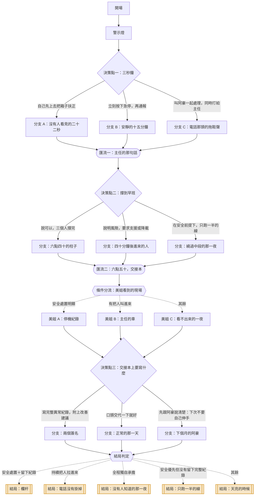

# 03｜《凌晨三點的警示燈》

> 輪班現場突發狀況　・　主題：壓力、責任與求援
>
> 黃燈轉起來的時候，線上只有三個人。原本應該有五個。

<!-- 這份文件由 tools/build-scripts.mjs 從 content/stories/story_03_three_am_alarm.json 產生，請勿手動編輯。 -->

| 項目 | 內容 |
|---|---|
| story_id | `story_03_three_am_alarm` |
| 版本 | 1.0.0（schema 1.0.0） |
| 對應島嶼 | 夜哨島（`island_night`） |
| 預估時間 | 約 3 分鐘 |
| 節點 / 決策點 / 選項 | 26 / 3 / 9 |
| 固定結局 / 航線 | 5 / 3 |
| 內容提醒 | 夜班、工安風險、人力不足 |

## 場景與情緒衝突

- **地點**：物流分揀中心，二號線。鐵皮屋頂，日光燈，輸送帶的聲音從來沒停過
- **時間**：星期四 凌晨 03:12
- **衝突**：七點的貨要出。人不夠。而剛剛那個聲音，不是正常的聲音。

## 人物

| 角色 | 身分 | 設定 | 說話方式 |
|---|---|---|---|
| 你 | 夜班組員 | 做夜班兩年。知道哪一段輸送帶會在濕氣重的時候打滑。 | 工作時話少，動作快 |
| 阿豪 | 新人 | 來三個禮拜。很認真，認真到有時候會做超出自己該做的事。 | 語尾會上揚，常常問『這樣對嗎』 |
| 黃主任 | 值班主管 | 住在廠區二十分鐘外。電話永遠會接，但人不一定會來。 | 睡醒的聲音，講話先吸一口氣 |
| 美姐 | 早班組長 | 做了十一年。交接本上她的字很用力，用力到背面會凸起來。 | 直接，不繞 |

## 狀態變數

航線判定只讀這些變數與選項標記，不讀其他任何東西。

| key | 名稱 | 初始值 | 說明 |
|---|---|---|---|
| `help` | 求援 | 0 | 你讓別人加入或接手的程度 |
| `safety` | 安全把關 | 0 | 你把安全放在進度前面的程度 |
| `hold` | 獨撐 | 0 | 你自己扛下來的部分 |
| `voice` | 開口 | 0 | 你把狀況說出來、留下紀錄的程度 |

## 流程圖

## 完整劇本

### 開場

`n_03_open`　・　旁白

*二號線　・　凌晨 03:12　・　規律到讓人恍神*

> 凌晨三點十二分。輸送帶的聲音像一條河，流了六個小時。
>
> 今晚該有五個人。有兩個請假，調不到人。
>
> 你、阿豪，還有在另一頭盤點的老張。七點的貨要出，進度剛好卡在一半。

**前往**：`n_03_alarm`

### 警示燈

`n_03_alarm`　・　旁白

*二號線中段　・　凌晨 03:14　・　聲音不對*

> **音效**（音效）：喀。喀喀。
>
> 聲音變了。不是平常那條河的聲音。
>
> 中段的黃燈轉起來，一圈一圈打在鐵皮屋頂上。
>
> 一個箱子歪在軌道接縫上，半個身體懸空，後面的箱子正在一個一個頂上去。
>
> 箱子側面印著：易碎・玻璃。
>
> **阿豪**：欸！這個是不是要——
>
> 阿豪已經往前跨了一步，手伸出去。

**前往**：`n_03_d1`

### 決策點一：三秒鐘

`n_03_d1`　・　決策點

*二號線中段　・　凌晨 03:14　・　腎上腺素*

> 急停鈕在你左手邊兩公尺，紅色的蘑菇頭。按下去，整條線停，進度歸零重啟要十五分鐘。

#### 選項：自己先上去把箱子扶正

`c_03_d1_fix`　・　副標：「線不要停，快一點就好」

**立即反應**

> **你**：你退開，我來。
>
> 你側身跨到檢修踏板上，一手撐著護欄，一手去搆那個箱子。
>
> 輸送帶在你腳邊繼續跑。你抓到箱子的邊角，用力一推——
>
> **音效**（音效）：咚。
>
> 箱子歸位，後面的隊伍重新流動。黃燈熄了。
>
> 你跳下踏板，手心全是汗。整件事花了二十二秒。

**實際後果**：線沒有停，進度保住了，而你剛剛在運轉中的機台上伸了手。

**心聲線索「心聲線索」**（`clue_03_twenty_two_seconds`）

> 你很熟練，所以你知道這樣做得到。熟練是真的，風險也是真的——這兩件事不衝突。值得問自己一句：剛剛那二十二秒，是我選的，還是進度幫我選的？

**狀態影響**：獨撐 +2、安全把關 -1　|　**標記**：`hold`　|　**前往**：`n_03_a1`

#### 選項：立刻按下急停，再通報

`c_03_d1_stop`　・　副標：「先停，其他的之後再說」

**立即反應**

> **你**：阿豪，手收回來！
>
> 你兩步跨過去，手掌拍在紅色蘑菇頭上。
>
> **音效**（音效）：整條線慢下來，停住。那條河第一次安靜。
>
> 安靜得你耳鳴。阿豪站在原地，手還半舉著。
>
> **阿豪**：⋯⋯啊。對不起。
>
> **你**：不是你的錯。線在跑的時候不能伸手，這是規定。

**實際後果**：線停了，十五分鐘的進度沒了，阿豪的手還在。

**心聲線索「心聲線索」**（`clue_03_the_button`）

> 按下急停會讓你被看見——燈會亮、紀錄會留、有人會問為什麼。不按，沒有人會知道。這就是為什麼很多人選擇不按。你按了。

**狀態影響**：安全把關 +2、開口 +1　|　**標記**：`safety`、`speak`　|　**前往**：`n_03_b1`

#### 選項：叫阿豪一起處理，同時打給主任

`c_03_d1_team`　・　副標：「兩個人做，而且讓上面知道」

**立即反應**

> **你**：阿豪，按急停，我打電話。站在按鈕旁邊不要動。
>
> 線停下來。你一邊看著那個歪掉的箱子，一邊撥號。響了四聲。
>
> **黃主任**：⋯⋯喂。
>
> **你**：主任，二號線中段卡箱，易碎品，我們已經急停。現在線上只有三個人。
>
> **黃主任**：等一下，我開個燈。
>
> 電話那頭傳來拖鞋的聲音。

**實際後果**：線停了，人到位了，而且這件事現在不只你一個人知道。

**心聲線索「心聲線索」**（`clue_03_two_people`）

> 你同時做了兩件事：把人配好，把訊息送出去。這代表你在混亂裡還保有判斷力。現場最容易丟掉的就是這個——因為所有的壓力都在叫你趕快動手。

**狀態影響**：求援 +2、安全把關 +1　|　**標記**：`help`、`safety`　|　**前往**：`n_03_c1`

### 分支 A：沒有人看見的二十二秒

`n_03_a1`　・　旁白

*二號線　・　凌晨 03:16　・　心跳還沒下來*

> **阿豪**：哇⋯⋯你好厲害喔。
>
> **阿豪**：那下次如果我遇到，也可以這樣用嗎？
>
> 你張開嘴，又閉上。
>
> **內心**（心聲）：他是在問一個做法。而他會照著做。

**前往**：`n_03_merge1`

### 分支 B：安靜的十五分鐘

`n_03_b1`　・　旁白

*二號線　・　凌晨 03:20　・　等重啟*

> 你把箱子搬下來，玻璃沒破。系統跳出一行紅字：異常停機・需填報。
>
> 重啟要十五分鐘。你看了一下進度條，七點的貨，開始有點危險。
>
> 手機震動。黃主任看到停機通知了。

**前往**：`n_03_merge1`

### 分支 C：電話那頭的拖鞋聲

`n_03_c1`　・　旁白

*二號線　・　凌晨 03:19　・　等指示*

> 阿豪把箱子搬下來。玻璃沒破。
>
> **阿豪**：剛剛我差點就伸手了。
>
> **你**：我知道。所以我才叫你去按按鈕。
>
> 電話那頭，黃主任正在看系統的遠端畫面。

**前往**：`n_03_merge1`

### 匯流一：主任的那句話

`n_03_merge1`　・　匯流　・　承接：`n_03_a1`、`n_03_b1`、`n_03_c1`

*二號線　・　凌晨 03:24　・　問題從機台轉到人*

> 黃主任的聲音從電話裡出來，背景有電視的聲音被關掉。
>
> **黃主任**：狀況我知道了。那個接縫下禮拜排保養。
>
> **黃主任**：現在調不到人，派遣那邊也沒有。七點那批一定要出，客戶那邊我扛不住。
>
> **黃主任**：你們三個⋯⋯撐到早班，可以嗎？
>
> 「可以嗎」三個字，聽起來像在問你。
>
> **內心**（心聲）：但如果你說不可以，接下來要處理的是什麼，你也知道。

**前往**：`n_03_d2`

### 決策點二：撐到早班

`n_03_d2`　・　決策點

*二號線　・　凌晨 03:25　・　責任落在手上*

> 距離早班交接還有三小時三十五分。阿豪在旁邊等你回答。

#### 選項：說可以，三個人撐完

`c_03_d2_comply`　・　副標：「講出來也不會多一個人」

**立即反應**

> **你**：好，我們處理。
>
> 電話掛了。你轉頭，阿豪的眼睛是紅的——不是哭，是太久沒睡。
>
> 接下來三個半小時，你們三個人做五個人的事。
>
> 六點四十，最後一板上車。你靠在柱子上，發現自己從三點以後沒有喝過水。

**實際後果**：貨準時出了。三個人做完五個人的量，這件事沒有被記在任何地方。

**心聲線索「心聲線索」**（`clue_03_said_yes`）

> 「反正講了也不會多一個人」——這句話常常是真的。但它會慢慢變成另一句：「所以不用講」。當現場從來不回報，缺口在報表上就不存在，於是人力永遠補不到。

**狀態影響**：獨撐 +2　|　**標記**：`hold`　|　**前往**：`n_03_a2`

#### 選項：說明風險，要求支援或降載

`c_03_d2_push`　・　副標：「把現在的狀況講清楚」

**立即反應**

> **你**：主任，我講一下現況。
>
> **你**：三個人跑完整條線，中段剛卡過一次，接縫還沒修。阿豪來三個禮拜，他的工序我要盯。
>
> **你**：我可以撐，但我要先講：這樣的條件下，再出一次狀況我處理不來。要嘛加人，要嘛減量。
>
> 電話那頭安靜了五秒。
>
> **黃主任**：⋯⋯好。我過去。四十分鐘。
>
> **黃主任**：那批先出八成，剩下的我跟客戶談。

**實際後果**：主任進廠，出貨量調整，而你把條件講在前面了。

**心聲線索「心聲線索」**（`clue_03_two_options`）

> 你沒有說「不行」，你說的是「這樣的條件下不行」，然後給了兩個選項。這讓對方有東西可以決定。單純的拒絕會讓對方卡住，附帶選項的說明會讓事情往前。

**狀態影響**：求援 +2、開口 +1　|　**標記**：`help`、`speak`　|　**前往**：`n_03_b2`

#### 選項：在安全前提下，只跑一半的線

`c_03_d2_partial`　・　副標：「能做多少做多少，但不冒險」

**立即反應**

> **你**：主任，中段那個接縫我不敢跑。我們把中段關掉，用一號線繞。
>
> **你**：速度會慢，七點大概出得了七成。剩下的三成我整理好，給早班接。
>
> **黃主任**：⋯⋯七成喔。
>
> 你聽見他在那頭吸了一口氣。
>
> **黃主任**：好啦。安全第一。你把沒出的那些列清楚，我早上跟客戶講。

**實際後果**：你用降速換掉了風險，缺口交給早班，而且交得清清楚楚。

**心聲線索「心聲線索」**（`clue_03_seven_tenths`）

> 七成不是失敗，是一個經過判斷的數字。最難的部分是：你得先接受「今天不會做完」，才有辦法安全地做到七成。很多現場出事，是因為沒有人願意先講出那個數字。

**狀態影響**：安全把關 +2、獨撐 +1　|　**標記**：`safety`　|　**前往**：`n_03_c2`

### 分支：六點四十的柱子

`n_03_a2`　・　旁白

*二號線　・　凌晨 06:40　・　撐完了*

> 最後一板上車，鐵捲門放下來。阿豪坐在空棧板上，整個人往後躺。
>
> **阿豪**：我們⋯⋯做完了喔？
>
> 你點頭。你想說點什麼鼓勵他，但喉嚨很乾，什麼都沒出來。

**前往**：`n_03_merge2`

### 分支：四十分鐘後進來的人

`n_03_b2`　・　旁白

*二號線　・　凌晨 04:08　・　多了一個人*

> 四點零八分，黃主任穿著夾克進來，頭髮亂的。他直接走到中段去看接縫。
>
> **黃主任**：這個⋯⋯真的不行。這個不能再跑。
>
> 他拿手機拍了三張照。
>
> **黃主任**：你剛剛那通電話打得對。

**前往**：`n_03_merge2`

### 分支：繞過中段的那一夜

`n_03_c2`　・　旁白

*一號線　・　凌晨 05:30　・　慢，但穩*

> 一號線比較窄，要多走十幾步。三個人輪著走，走了三個小時。
>
> 沒有再出任何狀況。那是今晚唯一值得高興的事。
>
> 你把沒出的三成列成清單，一箱一箱寫，寫到手痠。

**前往**：`n_03_merge2`

### 匯流二：六點五十，交接本

`n_03_merge2`　・　匯流　・　承接：`n_03_a2`、`n_03_b2`、`n_03_c2`

*交接台　・　凌晨 06:50　・　天開始亮*

> 鐵皮屋頂的縫透進一點灰藍色的光。早班的人陸續刷卡進來。
>
> 交接台上放著那本藍色的本子。美姐把包包放下，拉開椅子坐下。
>
> **美姐**：昨晚怎麼樣？

**前往**：`n_03_mei_check`

### 條件分流：美姐看到的現場

`n_03_mei_check`　・　條件分流

| 順序 | 條件 | 前往 | 說明 |
|---|---|---|---|
| 1 | 安全把關 >= 3 | `n_03_m_safe` | 安全處置明顯 |
| 2 | 求援 >= 2 | `n_03_m_backup` | 有把人叫進來 |
| 保底 | 以上皆不成立 | `n_03_m_quiet` | — |

### 美姐 A：停機紀錄

`n_03_m_safe`　・　旁白

*交接台　・　06:51　・　有跡可循*

> **美姐**：系統上有一筆異常停機，三點十四分。
>
> **美姐**：中段對不對。那個接縫我上個月就寫過，寫了兩次。
>
> 她翻開交接本，往前翻了幾頁，指給你看。她的字很用力。

**前往**：`n_03_d3`

### 美姐 B：主任的車

`n_03_m_backup`　・　旁白

*交接台　・　06:51　・　她注意到了*

> **美姐**：黃主任的車在外面。他半夜來過？
>
> 你點頭。
>
> **美姐**：他半夜會來，表示你講得夠清楚。
>
> **美姐**：我做十一年，他來過三次。

**前往**：`n_03_d3`

### 美姐 C：看不出來的一夜

`n_03_m_quiet`　・　旁白

*交接台　・　06:51　・　表面上什麼都沒發生*

> 美姐翻開交接本，看了一眼進度數字。
>
> **美姐**：數字很漂亮欸。三個人跑出這個量。
>
> 她抬頭看你，又看了一眼坐在棧板上的阿豪。
>
> **美姐**：⋯⋯太漂亮了。

**前往**：`n_03_d3`

### 決策點三：交接本上要寫什麼

`n_03_d3`　・　決策點

*交接台　・　06:52　・　最後一個動作*

> 本子攤開著。筆在旁邊。你的手很重，但這是今天最後一件事。

#### 選項：寫完整異常紀錄，附上改善建議

`c_03_d3_record`　・　副標：「讓這件事留下來」

**立即反應**

> 你寫了半頁：三點十四分中段卡箱、易碎品、處置方式、停機時間、人力配置三人。
>
> 最後一行你寫：建議接縫優先排修，夜班低於四人時，中段降速運轉。
>
> 美姐讀完，拿起筆，在你那段下面簽了名。
>
> **美姐**：我連署。兩個人寫，比一個人寫有用。

**實際後果**：這一夜變成一份有兩個簽名的紀錄，上面看得到。

**心聲線索「心聲線索」**（`clue_03_on_paper`）

> 寫下來不是為了追究誰。是因為沒有被寫下來的事，在制度眼裡等於沒發生過——包括你今晚承受的那些。要讓條件改變，得先讓它存在。

**狀態影響**：安全把關 +2、開口 +2　|　**標記**：`safety`、`speak`　|　**前往**：`n_03_a3`

#### 選項：口頭交代一下就好

`c_03_d3_verbal`　・　副標：「太累了，講完就想走」

**立即反應**

> **你**：中段卡過一次，處理掉了。其他正常。
>
> **美姐**：嗯。
>
> 你在交接本上寫了兩個字：正常。
>
> 筆放下的時候，你發現自己的手在抖。可能是太久沒吃東西。

**實際後果**：這一夜在紙上是「正常」。下一班的人會從正常開始。

**心聲線索「心聲線索」**（`clue_03_normal`）

> 寫下「正常」只要兩秒，寫下實情要十分鐘，而你現在連站著都很勉強。這個選擇完全可以理解。只是那兩個字會變成下一班的起點，也會變成報表上的常態。

**狀態影響**：獨撐 +1　|　**標記**：`hold`　|　**前往**：`n_03_b3`

#### 選項：先跟阿豪說清楚：下次不要自己伸手

`c_03_d3_tell_hao`　・　副標：「有些事比紀錄更急」

**立即反應**

> 你走到棧板旁邊，坐下來。阿豪抬頭。
>
> **你**：阿豪，有件事我要跟你講。
>
> **你**：線在跑的時候，不管看到什麼，手都不要伸進去。先按急停，被念是我的事。
>
> **阿豪**：可是停了進度就⋯⋯
>
> **你**：進度可以補。手不行。
>
> 阿豪愣了一下，然後很用力地點頭。

**實際後果**：你把一條規矩交給了他，而且是用他聽得懂的方式。

**心聲線索「心聲線索」**（`clue_03_passed_on`）

> 新人學的不是手冊，是看前輩怎麼做。你今天教他的是哪一個版本，他明年就會變成哪一個版本——而這件事通常沒有人會特地跟你說。

**狀態影響**：求援 +2、開口 +1　|　**標記**：`help`　|　**前往**：`n_03_c3`

### 分支：兩個簽名

`n_03_a3`　・　旁白

*停車場　・　07:10　・　太陽出來了*

> 走出廠房，太陽已經整個出來，刺得眼睛睜不開。
>
> 三天後，中段接縫排進保養排程，比原定提早了一週。

**前往**：`n_03_ending_check`

### 分支：正常的那一天

`n_03_b3`　・　旁白

*停車場　・　07:10　・　空白*

> 你騎車回家，在紅燈前面停下來，發呆了一下，後面的車按喇叭。
>
> 回到家躺下，天已經很亮了。窗簾擋不住。

**前往**：`n_03_ending_check`

### 分支：下個月的阿豪

`n_03_c3`　・　旁白

*廠房外　・　07:10　・　有東西傳下去了*

> 下個月，一號線有個新人想伸手去撿掉下去的東西。
>
> **阿豪**：欸欸欸！手！先按急停！
>
> 阿豪的聲音，你在另一頭聽到了。

**前往**：`n_03_ending_check`

### 結局判定

`n_03_ending_check`　・　條件分流

| 順序 | 條件 | 前往 | 說明 |
|---|---|---|---|
| 1 | 安全把關 >= 4 且 開口 >= 3 | `n_03_e_railing` | 安全處置＋留下紀錄 |
| 2 | 求援 >= 4 | `n_03_e_line_open` | 持續把人拉進來 |
| 3 | 標記「hold」次數 >= 2 且 安全把關 <= 0 | `n_03_e_alone` | 全程獨自承擔 |
| 4 | 安全把關 >= 3 | `n_03_e_half` | 安全優先但沒有留下完整紀錄 |
| 保底 | 以上皆不成立 | `n_03_e_dawn` | — |

## 結局

### 欄杆

`e_03_railing`　・　節點 `n_03_e_railing`　・　標籤：`safety`、`systemic`

> 兩個禮拜後，中段裝上新的護欄，轉角多了一盞警示燈。
>
> 沒有人在群組裡講這件事。工程單上寫著：依交接紀錄辦理。
>
> 你經過的時候，順手摸了一下那根欄杆。冰的，很穩。

**結局回顧**：這一次，你把安全放在進度前面，而且把它寫下來了。

> 現場最珍貴的不是誰最會處理突發狀況，是誰願意讓突發狀況留下紀錄。因為紀錄會變成欄杆，欄杆會接住下一個人。

### 電話沒有掛掉

`e_03_line_open`　・　節點 `n_03_e_line_open`　・　標籤：`help`、`connection`

> 後來的夜班，你和黃主任之間多了一種默契：有狀況，先講，不要等到撐不住才講。
>
> 他不是每次都來。但你每次都說。
>
> 這條線沒有斷過。

**結局回顧**：這一次，你讓別人進到現場了。

> 一個人在凌晨三點做的判斷，不應該只有一個人承擔。你把線打開了——而線只要開著，下一次就比較容易開口。

### 沒有人知道的那一夜

`e_03_alone`　・　節點 `n_03_e_alone`　・　標籤：`hold`、`invisible_cost`

> 那一夜的數字很漂亮。三個人，跑出五個人的量。
>
> 系統上沒有異常，交接本上寫著正常。
>
> 下個月排班，夜班還是三個人。因為報表說，三個人做得完。

**結局回顧**：這一次，你一個人把它接下來了。

> 你的能力是真的。但當缺口每次都被能力補起來，缺口在制度眼裡就不存在。這不是你的錯——只是值得知道，這就是它運作的方式。

### 只跑一半的線

`e_03_half`　・　節點 `n_03_e_half`　・　標籤：`safety`

> 七點，出了七成。客戶那邊黃主任去談，談成了。
>
> 沒有人受傷，玻璃沒有破，三個人都準時下班。
>
> 這是一個不會被寫進任何成功案例的夜班。

**結局回顧**：這一次，你用降速換掉了風險。

> 「做到七成」需要比「硬做完」更多的判斷力，因為你得先承認今天做不完。這個承認，往往是現場最難的那一步。

### 天亮的時候

`e_03_dawn`　・　節點 `n_03_e_dawn`　・　標籤：`mixed`

> 走出鐵捲門，天完全亮了。空氣有一點涼，聞得到柏油和露水。
>
> 這一夜過去了。有些事你處理了，有些事還留在那裡。
>
> 你騎上車。今天要睡到幾點，由你自己決定。

**結局回顧**：這一次，你把它撐過來了，用你自己的方式。

> 夜班的時間感和別人不一樣。有時候一夜平安就已經是很好的結果了，不需要再多一個意義。

## 結局判定

| 順序 | 條件 | 結局 |
|---|---|---|
| 1 | 安全把關 >= 4 且 開口 >= 3 | 結局：欄杆 |
| 2 | 求援 >= 4 | 結局：電話沒有掛掉 |
| 3 | 標記「hold」次數 >= 2 且 安全把關 <= 0 | 結局：沒有人知道的那一夜 |
| 4 | 安全把關 >= 3 | 結局：只跑一半的線 |
| 保底 | 以上皆不成立 | 結局：天亮的時候 |

## 三條航線

航線由固定規則判定，依 priority 由小到大評估，第一個命中的即為結果；最後一條是保底規則，
所以任何遊玩組合都會落在恰好一條航線上。AI 不參與這個判定。

### 1. 求援航線

`r_03_help`

**敘事意涵**：主動把人拉進現場——叫同事、打電話、或把規矩交給下一個人。重點是這件事不再只在你一個人手上。

**判定規則**：標記「help」次數 >= 1 或 求援 >= 2

**航線解析（玩家看到的文案）**

> 你走的是「求援航線」。
>
> 凌晨三點最容易發生的事，是一個人默默把它處理掉。你沒有。你讓別人知道、讓別人進來、或把判斷傳給下一個人。
>
> 求援需要先承認「我需要」。在一個獎勵耐操的環境裡，這句話比動手還難說出口。

**情緒練習卡**：《求援的三句話》把求救變成一個可以照唸的格式（`pc_03_help`，約 2 分鐘）

**島嶼地景**：無線電塔　——　岩頂立起一座塔。它的用途只有一個：讓訊號出得去。

> 岩頂立起一座塔。從這裡發出去的訊號，別的島收得到。

新增地塊 1 個、新增物件 1 個。

### 2. 安全優先航線

`r_03_safety`

**敘事意涵**：在進度與安全之間，選擇安全——按下急停、降速、把風險寫下來。重點是你願意承擔「沒做完」的後果。

**判定規則**：安全把關 >= 3 或 標記「safety」次數 >= 2

**航線解析（玩家看到的文案）**

> 你走的是「安全優先航線」。
>
> 你按下了那個會讓自己被看見的按鈕，或是講出了那個會讓進度難看的數字。
>
> 這條航線的代價是當下的壓力，換到的是沒有人受傷。這個交換在事後通常沒有人會感謝，因為沒發生的事看不見。

**情緒練習卡**：《先寫下來》讓下一班的人不用再試一次（`pc_03_safety`，約 5 分鐘）

**島嶼地景**：警示燈與欄杆　——　危險的邊緣架起欄杆，轉角裝上一盞燈。事故不會因此消失，但下一個人看得到。

> 島的邊緣架起欄杆，轉角裝上一盞燈。給下一個走這條路的人。

新增地塊 1 個、新增物件 2 個。

### 3. 獨撐航線

`r_03_hold`

**敘事意涵**：保底航線。以自己處理、照指示撐完、不留紀錄為主的所有組合。不代表錯，代表這一夜的重量主要由你自己承接。

**判定規則**：永遠成立（保底）

**航線解析（玩家看到的文案）**

> 你走的是「獨撐航線」。
>
> 你很熟練，所以你做得到。事情確實被你處理掉了，而且處理得又快又乾淨。
>
> 只是「乾淨」在這裡有一個副作用：從外面看，今晚什麼都沒發生。包括你。

**情緒練習卡**：《撐住之後，先落地》身體還留在凌晨三點的時候（`pc_03_hold`，約 3 分鐘）

**島嶼地景**：避風的凹岸　——　岩壁被海挖出一個凹口，剛好擋住主要的風向。

> 岩壁被海挖出一個凹口。不大，但剛好可以躲一下。

新增地塊 1 個、新增物件 1 個。

## 重新遊玩可以探索的

- 第一個決策點的處置方式，會決定阿豪在下個月遇到同樣狀況時怎麼做。
- 黃主任會不會半夜開車進廠，取決於你在第二個決策點講了什麼。
- 美姐在交接台說的話有三個版本——她看的是系統紀錄、停車場、還是那個太漂亮的數字。
- 這篇故事有五個固定結局與三條航線，其中「欄杆」需要你同時做到安全處置與留下紀錄。

