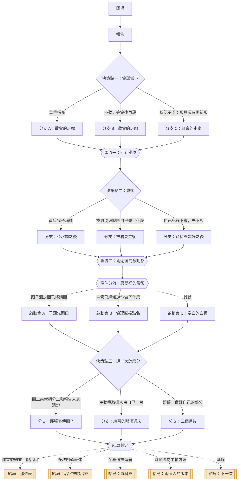

# 04｜《那份簡報的名字》

> 工作成果未被看見　・　主題：公平、人際關係與溝通
>
> 投影幕上是你做了三個禮拜的東西。上台報告的人，從頭到尾沒有提到你。

<!-- 這份文件由 tools/build-scripts.mjs 從 content/stories/story_04_name_on_the_deck.json 產生，請勿手動編輯。 -->

| 項目 | 內容 |
|---|---|
| story_id | `story_04_name_on_the_deck` |
| 版本 | 1.0.0（schema 1.0.0） |
| 對應島嶼 | 署名島（`island_credit`） |
| 預估時間 | 約 3 分鐘 |
| 節點 / 決策點 / 選項 | 26 / 3 / 9 |
| 固定結局 / 航線 | 5 / 3 |
| 內容提醒 | 職場人際、功勞歸屬 |

## 場景與情緒衝突

- **地點**：公司大會議室，二十幾個人，投影幕，季度檢討
- **時間**：星期五下午 14:30
- **衝突**：你知道那是你做的。但指出來要花的力氣，比做那份簡報還多。

## 人物

| 角色 | 身分 | 設定 | 說話方式 |
|---|---|---|---|
| 你 | 行銷企劃 | 三週前接到市場分析的任務，資料自己跑、圖自己拉、架構自己排。 | 會先想「這樣講會不會不好」 |
| 子涵 | 同組同事 | 口條好、台風穩，部門有對外報告通常找她。她不是壞人，她只是習慣了。 | 流利、自然，講到數字會停一拍加強語氣 |
| 周協理 | 部門主管 | 看結果不看過程。不是不在乎，是沒時間在乎。 | 短句，問題直接 |
| 阿凱 | 隔壁組同事 | 坐你旁邊三年。會在群組裡丟很爛的梗圖。 | 嘴上沒正經，但看得很準 |

## 狀態變數

航線判定只讀這些變數與選項標記，不讀其他任何東西。

| key | 名稱 | 初始值 | 說明 |
|---|---|---|---|
| `speak` | 表達 | 0 | 你把自己做的事講出來的程度 |
| `rules` | 建立規則 | 0 | 你把事情變成可依循規則的程度 |
| `keep` | 留著 | 0 | 你選擇先不說、自己收著的部分 |
| `relation` | 關係 | 0 | 你與子涵之間直接溝通的程度 |

## 流程圖

## 完整劇本

### 開場

`n_04_open`　・　旁白

*大會議室　・　星期五 14:30　・　有點悶的冷氣*

> 季度檢討。二十幾個人，冷氣開得很強，後排有人在滑手機。
>
> 輪到行銷組。子涵走到前面，接上投影線。
>
> 投影幕亮起來。那是你的封面——你調了四次的配色，右下角那條細線也是你加的。

**前往**：`n_04_report`

### 報告

`n_04_report`　・　旁白

*大會議室　・　星期五 14:38　・　越聽越安靜*

> **子涵**：這一季我們針對 25 到 34 歲族群做了比較完整的分析——
>
> 第三頁。那張交叉比對的圖，你跑了兩天的資料。
>
> **子涵**：這邊大家可以看到，回購率的轉折點其實落在第三次購買，不是我們原本以為的第二次。
>
> **周協理**：這個發現不錯。誰做的？
>
> 你的心跳快了一拍。
>
> **子涵**：我們組這次花蠻多時間在資料上的，有特別去拉三年的紀錄。
>
> **周協理**：嗯，很好。繼續。
>
> 「我們組」。
>
> **內心**（心聲）：她沒有說謊。那確實是這一組做的。

**前往**：`n_04_d1`

### 決策點一：會議當下

`n_04_d1`　・　決策點

*大會議室　・　星期五 14:41　・　手放在桌子下面*

> 還有三頁。阿凱在旁邊用手肘頂了你一下，沒有看你。

#### 選項：舉手補充

`c_04_d1_add`　・　副標：「現在不說，等一下就沒有位置了」

**立即反應**

> 你把手舉到一半，又覺得太高，改成抬了一下。
>
> **你**：協理，我補充一下第三頁。那個轉折點是我在拉三年資料的時候發現的，原本模型沒有跑出來，是手動交叉比對才看到。
>
> **你**：如果要延伸，我這邊還有分齡的版本。
>
> 會議室安靜了一秒。子涵的手停在翻頁器上。
>
> **周協理**：喔，那個分齡的版本給我看一下。下週。
>
> **子涵**：對，這部分是他做的，我剛剛講太快。

**實際後果**：房間裡的人知道了那張圖是誰做的，氣氛也變了一點。

**心聲線索「心聲線索」**（`clue_04_raise_hand`）

> 你講的是事實，不是情緒——「我在拉資料的時候發現的」。這種說法很難被當成爭功，因為它只是在補資訊。那一秒的安靜不是尷尬，是房間在更新資料。

**狀態影響**：表達 +2　|　**標記**：`speak`　|　**前往**：`n_04_a1`

#### 選項：不動，等會後再說

`c_04_d1_silent`　・　副標：「當場打斷太尷尬了」

**立即反應**

> 你沒有動。手指在桌子底下把筆蓋套上、拔開、套上。
>
> 後面三頁你一句都沒聽進去。
>
> 報告結束，大家鼓掌。你也鼓了。
>
> **內心**（心聲）：手掌拍在一起的時候，你在想自己為什麼要拍。

**實際後果**：會議紀錄上，這份分析屬於「行銷組」。

**心聲線索「心聲線索」**（`clue_04_the_clap`）

> 當場不說，通常不是因為不在乎，是因為同時要承擔太多東西——打斷的尷尬、被當成計較、把場面弄僵。你一個人在三秒內評估完這些，然後決定自己吸收。這很耗力氣，雖然沒有人看得到。

**狀態影響**：留著 +2　|　**標記**：`keep`　|　**前往**：`n_04_b1`

#### 選項：私訊子涵：那頁我有更新版

`c_04_d1_dm`　・　副標：「用側面的方式提一下」

**立即反應**

> **你**（訊息）：第三頁那個圖我後來有更新版，分齡的，等等傳給你
>
> 子涵在台上看了一眼手機，比了一個 OK 的手勢，繼續講。
>
> **子涵**（訊息）：好 感謝～
>
> 「感謝」。你看著那兩個字，看了一下。

**實際後果**：你提醒了她那是你做的，用一種她可以不用回應的方式。

**心聲線索「心聲線索」**（`clue_04_side_door`）

> 側面的提醒最安全，也最容易被接收成另一個意思。你心裡想的是「那是我做的」，傳出去的版本是「我有更新檔」。對方只會回應她收到的那個版本。

**狀態影響**：關係 +1、留著 +1　|　**標記**：`keep`　|　**前往**：`n_04_c1`

### 分支 A：散會的走廊

`n_04_a1`　・　旁白

*走廊　・　星期五 15:20　・　有點僵*

> 散會，子涵收線材的動作比平常慢。
>
> **阿凱**：欸，剛剛那個。
>
> **阿凱**：講得好。我上次就沒講，到現在還在想。

**前往**：`n_04_merge1`

### 分支 B：散會的走廊

`n_04_b1`　・　旁白

*走廊　・　星期五 15:20　・　悶*

> **阿凱**：第三頁那個是你做的吧。
>
> 你愣了一下。
>
> **阿凱**：你那個配色我認得。右下角那條線，很你。
>
> 有人認出來了。這件事讓你好過一點，也讓你更難過一點。

**前往**：`n_04_merge1`

### 分支 C：散會的走廊

`n_04_c1`　・　旁白

*走廊　・　星期五 15:20　・　說不上來*

> 子涵走過來，拍了一下你的肩膀。
>
> **子涵**：更新版記得傳我喔，下禮拜要給協理的我再整理。
>
> 她說完就往茶水間走了。語氣很正常，正常到你找不到地方接話。

**前往**：`n_04_merge1`

### 匯流一：回到座位

`n_04_merge1`　・　匯流　・　承接：`n_04_a1`、`n_04_b1`、`n_04_c1`

*座位　・　星期五 15:35　・　下班前的兩小時*

> 回到座位，螢幕上還開著那份簡報的原始檔。檔名是「市場分析_v7_final_真的final」。
>
> 修改紀錄裡，從 v1 到 v7，只有一個人的名字。

**條件式對白**　若：標記「speak」次數 >= 1

> **內心**（心聲）：剛剛講完之後，心跳到現在還沒完全下來。但不是後悔的那種。

**條件式對白**　若：留著 >= 2

> **內心**（心聲）：從 v1 到 v7。這件事只有這個檔案知道。

**前往**：`n_04_d2`

### 決策點二：會後

`n_04_d2`　・　決策點

*座位　・　星期五 15:40　・　還有時間做點什麼*

> 子涵在茶水間。周協理的辦公室門開著。你的備忘錄是空白的。

#### 選項：直接找子涵談

`c_04_d2_talk`　・　副標：「把話講開，比猜來猜去好」

**立即反應**

> **你**：子涵，我想跟你講一下今天的簡報。
>
> **你**：第三到第六頁是我做的。協理問『誰做的』的時候，我其實蠻希望你講我的名字。
>
> 子涵放下杯子。她的表情是真的愣住。
>
> **子涵**：⋯⋯我以為講『我們組』比較好。
>
> **子涵**：我之前被說過太愛講誰誰誰做的，好像在分。所以我後來都講組。
>
> **子涵**：對不起，我沒想到這樣會讓你⋯⋯對不起。
>
> 你們兩個站在茶水間，都有點不知道手要放哪裡。

**實際後果**：你知道了她不是故意的，她知道了這件事對你有重量。

**心聲線索「心聲線索」**（`clue_04_she_didnt_know`）

> 很多「被忽略」不是有人決定要忽略你，是兩個人用不同的規則在運作。把規則講出來，比猜對方的動機有用。不過要提醒自己：知道她不是故意的，不代表你的不舒服就不算數。兩件事可以同時成立。

**狀態影響**：表達 +2、關係 +1　|　**標記**：`speak`　|　**前往**：`n_04_a2`

#### 選項：找周協理說明自己做了什麼

`c_04_d2_boss`　・　副標：「讓決定資源的人知道」

**立即反應**

> 你拿著筆電走進去。
>
> **你**：協理，你剛剛說要分齡的版本，我現在給你看。
>
> 你打開檔案，順手把修改紀錄也拉出來。
>
> **你**：這份從三週前開始做的，資料清洗跟交叉比對是我處理的。這是過程檔。
>
> **周協理**：喔。
>
> 他看了螢幕三秒。
>
> **周協理**：那下一季這塊你負責。報告也你來。
>
> 就這樣。沒有安慰，沒有評論，直接給了下一件事。

**實際後果**：決定資源的人現在知道了，而且他的反應是給你更多工作。

**心聲線索「心聲線索」**（`clue_04_show_the_log`）

> 你用檔案說話，沒有用情緒。這在很多主管面前最有效——因為他要的不是誰委屈，是誰能交付。只是值得留意：被看見之後，通常跟著來的是更多責任，而不是更多照顧。

**狀態影響**：表達 +2、建立規則 +1　|　**標記**：`speak`　|　**前往**：`n_04_b2`

#### 選項：自己記錄下來，先不說

`c_04_d2_log`　・　副標：「留著，以後再說」

**立即反應**

> 你開了一個新資料夾，名字取得很無聊：「專案備份」。
>
> 把原始資料、過程檔、你跟子涵的對話截圖，都丟進去。
>
> 再開一個文字檔，寫了日期和三行字。
>
> **內心**（心聲）：不是要告誰。只是不想有一天連自己都開始懷疑這件事是不是我做的。

**實際後果**：東西留下來了，但房間裡的人還是不知道。

**心聲線索「心聲線索」**（`clue_04_the_folder`）

> 「不想連自己都開始懷疑」——這句話很重要。被長期略過的人，最後會懷疑的往往不是別人，是自己的記憶。先把證據留著，是在保護這個。至於要不要拿出來，什麼時候拿，都還是你的選擇。

**狀態影響**：留著 +2　|　**標記**：`keep`　|　**前往**：`n_04_c2`

### 分支：茶水間之後

`n_04_a2`　・　旁白

*座位　・　星期五 16:10　・　鬆了一些*

> 下午四點十分，子涵傳來一則訊息。
>
> **子涵**（訊息）：我剛剛跟協理說第三到第六頁是你做的。他說他知道了。
>
> **子涵**（訊息）：下次我會講名字。真的抱歉。

**前往**：`n_04_merge2`

### 分支：被看見之後

`n_04_b2`　・　旁白

*座位　・　星期五 16:10　・　複雜*

> 你回到座位，行事曆上多了一個下週的會議：市場分析・下季規劃（主責）。
>
> 阿凱探頭過來看了一眼。
>
> **阿凱**：恭喜升官，薪水有沒有一起升？
>
> 他說完自己先笑了。你沒有笑。

**前往**：`n_04_merge2`

### 分支：資料夾建好之後

`n_04_c2`　・　旁白

*座位　・　星期五 16:10　・　安靜*

> 資料夾建好了，二十七個檔案。你把它拖到最不顯眼的位置。
>
> 然後你繼續做下一件事。效率很好，今天的進度超前。

**前往**：`n_04_merge2`

### 匯流二：兩週後的啟動會

`n_04_merge2`　・　匯流　・　承接：`n_04_a2`、`n_04_b2`、`n_04_c2`

*小會議室　・　兩週後 10:00　・　新的開始*

> 兩週後，下一個專案啟動會。小會議室，六個人。
>
> **周協理**：這個案子三個月，分工自己喬。報告人先定一下，我要排上層的時間。
>
> 白板上寫著四個工作項目，下面都還是空的。

**前往**：`n_04_kick_check`

### 條件分流：房間裡的氣氛

`n_04_kick_check`　・　條件分流

| 順序 | 條件 | 前往 | 說明 |
|---|---|---|---|
| 1 | 關係 >= 1 | `n_04_k_open` | 跟子涵之間已經講開 |
| 2 | 表達 >= 2 | `n_04_k_known` | 主管已經知道你做了什麼 |
| 保底 | 以上皆不成立 | `n_04_k_blank` | — |

### 啟動會 A：子涵先開口

`n_04_k_open`　・　旁白

*小會議室　・　兩週後 10:03　・　有人幫你撐著*

> **子涵**：我先講，資料那塊上次是他做的，這次應該也是他比較熟。
>
> 她看了你一眼，等你接。
>
> 白板上的筆被遞過來，在你手上。

**前往**：`n_04_d3`

### 啟動會 B：協理直接點名

`n_04_k_known`　・　旁白

*小會議室　・　兩週後 10:03　・　被放上去了*

> **周協理**：資料那塊你來，上次那個轉折點抓得不錯。
>
> 他說完就低頭看手機。其他人看著白板。
>
> 筆在桌子中間，沒有人去拿。

**前往**：`n_04_d3`

### 啟動會 C：空白的白板

`n_04_k_blank`　・　旁白

*小會議室　・　兩週後 10:03　・　重來一次*

> 沒有人先講話。大家在等一個人開口。
>
> **子涵**：那⋯⋯我報告好了？反正我比較習慣。
>
> 筆在桌子中間。離你大概三十公分。

**前往**：`n_04_d3`

### 決策點三：這一次怎麼分

`n_04_d3`　・　決策點

*小會議室　・　兩週後 10:05　・　可以不一樣*

> 白板空著。三個月的案子，現在決定的事，三個月後會變成結果。

#### 選項：開工前就把分工和報告人寫清楚

`c_04_d3_rules`　・　副標：「事前講，比事後講容易」

**立即反應**

> 你拿起筆，在白板上畫了三欄：做什麼、誰做、誰報告。
>
> **你**：我先列一版，大家看看對不對。
>
> 寫到一半，阿凱說「等等我那欄寫錯了」，站起來自己改。然後是子涵。
>
> 十分鐘後，白板上每一格都有名字。
>
> **周協理**：這個拍一下傳群組。以後都這樣。

**實際後果**：這個案子從第一天就有分工表，而且成了部門的新做法。

**心聲線索「心聲線索」**（`clue_04_three_columns`）

> 同一件事，事後講叫爭功勞，事前講叫流程。你把時間點換掉了，難度就完全不同。這不是小聰明，這是在改變遊戲的規則，而不是在規則裡辛苦。

**狀態影響**：建立規則 +2、表達 +1　|　**標記**：`rules`　|　**前往**：`n_04_a3`

#### 選項：主動爭取這次由自己上台

`c_04_d3_present`　・　副標：「站到前面去」

**立即反應**

> **你**：這次我報告。
>
> 你自己也有點驚訝這句話這麼快就出來了。
>
> **你**：資料我最熟，問答的部分我接得住。台風我會練。
>
> **子涵**：可以啊。要練的話我陪你跑一次。
>
> **周協理**：好。下次換你。
>
> 就這樣決定了。花了十五秒。

**實際後果**：下一次站在投影幕前面的人是你。

**心聲線索「心聲線索」**（`clue_04_i_will_present`）

> 你以為會很難，結果花了十五秒。很多位置不是被搶走的，是空著沒有人要——因為大家都以為要先被肯定，才有資格舉手。順序其實常常是反過來的。

**狀態影響**：表達 +2、建立規則 +1　|　**標記**：`speak`　|　**前往**：`n_04_b3`

#### 選項：照舊，做好自己的部分

`c_04_d3_same`　・　副標：「把事情做好，總會有人看到」

**立即反應**

> **你**：我做資料就好。
>
> **子涵**：好，那報告我來。
>
> 白板上「誰報告」那一欄，寫上了子涵。
>
> 會議五分鐘就結束了。效率很高。

**實際後果**：分工跟上次一樣。三個月後，大概也會一樣。

**心聲線索「心聲線索」**（`clue_04_same_again`）

> 「把事情做好總會有人看到」——這在有些環境是真的，在有些環境不是。差別不在你努不努力，在那個環境有沒有讓貢獻被看見的機制。如果沒有，那就不是你的問題，而是一個需要被處理的條件。

**狀態影響**：留著 +2　|　**標記**：`keep`　|　**前往**：`n_04_c3`

### 分支：那張表傳開了

`n_04_a3`　・　旁白

*公司群組　・　當天下午　・　有東西擴散出去*

> 白板的照片被傳到部門群組。隔天，另一組的啟動會也畫了一樣的三欄。
>
> **阿凱**（訊息）：欸你那個表我偷走了
>
> **阿凱**（訊息）：我們組吵三個月的事，十分鐘寫完

**前往**：`n_04_ending_check`

### 分支：練習的那個週末

`n_04_b3`　・　旁白

*空會議室　・　週六下午　・　緊張但往前*

> 你跑了四次。子涵在台下當觀眾，第三次的時候她說「這邊停一下，讓數字落地」。
>
> 你照做，果然不一樣。

**前往**：`n_04_ending_check`

### 分支：三個月後

`n_04_c3`　・　旁白

*大會議室　・　三個月後　・　似曾相識*

> 三個月後的季度檢討。投影幕亮起來，封面是你排的。
>
> 子涵站在前面。協理問了一句「這個誰做的」。
>
> 你的手指在桌子底下，把筆蓋套上、拔開。

**前往**：`n_04_ending_check`

### 結局判定

`n_04_ending_check`　・　條件分流

| 順序 | 條件 | 前往 | 說明 |
|---|---|---|---|
| 1 | 建立規則 >= 3 且 表達 >= 3 | `n_04_e_table` | 建立規則並且說出口 |
| 2 | 表達 >= 4 | `n_04_e_name` | 多次明確表達 |
| 3 | 標記「keep」次數 >= 3 | `n_04_e_folder` | 全程選擇留著 |
| 4 | 關係 >= 2 | `n_04_e_two` | 以關係為主軸處理 |
| 保底 | 以上皆不成立 | `n_04_e_next` | — |

## 結局

### 那張表

`e_04_table`　・　節點 `n_04_e_table`　・　標籤：`systemic`、`spoken`

> 半年後，部門的啟動會都會先畫那三欄。沒有人記得是誰開始的。
>
> 但每一次有人在「誰報告」那一欄寫下自己的名字，就有一個人不用再經歷你那天下午。

**結局回顧**：這一次，你沒有去爭那一次，你改掉了下一百次。

> 個人的委屈很難講，流程的缺口很好講。你把問題換了一個層次，於是它從「你計較」變成「我們之前沒定」。

### 名字被唸出來

`e_04_name`　・　節點 `n_04_e_name`　・　標籤：`speak`

> 下一季的檢討會，投影幕亮起來，站在前面的是你。
>
> 講到第三頁的時候，你停了一拍，讓數字落地——這是子涵教你的。
>
> 後排有人抬起頭。

**結局回顧**：這一次，你把自己放到了被看見的位置。

> 被看見這件事，有一部分要靠別人，有一部分要靠自己站過去。你做了可以做的那一部分。

### 資料夾

`e_04_folder`　・　節點 `n_04_e_folder`　・　標籤：`keep`

> 那個叫「專案備份」的資料夾，後來有六十幾個檔案。
>
> 你沒有打開過，也沒有給誰看過。
>
> 但它在那裡。每次有人說「這是我們組做的」，你都知道還有另一個版本。

**結局回顧**：這一次，你選擇先留著。

> 留著不是輸。被長期略過的人最後會懷疑自己的記憶，而你把證據留下來了——要不要拿出來、什麼時候拿，都還是你的選擇。

### 兩個人的版本

`e_04_two`　・　節點 `n_04_e_two`　・　標籤：`relation`

> 後來你跟子涵之間有了一種新的習慣：東西交出去之前，兩個人會先對一次「這是誰的部分」。
>
> 不是每次都記得。但記得的那幾次，都比較好過。

**結局回顧**：這一次，你把話跟當事人講開了。

> 多數「被忽略」不是惡意，是兩個人用不同的規則在運作。把規則講開不會讓不舒服消失，但它會讓下一次有機會不一樣。

### 下一次

`e_04_next`　・　節點 `n_04_e_next`　・　標籤：`mixed`

> 這一季過去了。投影幕暗下來，大家收東西。
>
> 有些話你說了一半，有些留著。
>
> 三個月後還會有一次季度檢討。那時候的你，可以是另一個版本。

**結局回顧**：這一次，你做了一部分，留了一部分。

> 不是每件事都要一次處理完。知道自己卡在哪裡，就已經和完全沒有察覺不一樣了。

## 結局判定

| 順序 | 條件 | 結局 |
|---|---|---|
| 1 | 建立規則 >= 3 且 表達 >= 3 | 結局：那張表 |
| 2 | 表達 >= 4 | 結局：名字被唸出來 |
| 3 | 標記「keep」次數 >= 3 | 結局：資料夾 |
| 4 | 關係 >= 2 | 結局：兩個人的版本 |
| 保底 | 以上皆不成立 | 結局：下一次 |

## 三條航線

航線由固定規則判定，依 priority 由小到大評估，第一個命中的即為結果；最後一條是保底規則，
所以任何遊玩組合都會落在恰好一條航線上。AI 不參與這個判定。

### 1. 建立規則航線

`r_04_rules`

**敘事意涵**：把個別的委屈，轉成事前就講清楚的流程——分工表、報告人、署名方式。重點是改變的是下一次，不是這一次。

**判定規則**：標記「rules」次數 >= 1 或 建立規則 >= 3

**航線解析（玩家看到的文案）**

> 你走的是「建立規則航線」。
>
> 你沒有把力氣花在爭這一次，而是去改下一次的玩法。
>
> 同一句話，事後講叫計較，事前講叫流程。你換掉了時間點，於是難度整個不一樣了。

**情緒練習卡**：《開工前的一張表》分工講在前面，比事後講容易（`pc_04_rules`，約 5 分鐘）

**島嶼地景**：共用碼頭　——　一座大家都能停靠的碼頭，每個泊位都有編號。

> 海邊築起一座碼頭，每個泊位都標了號碼。誰停哪裡，一眼就看得出來。

新增地塊 1 個、新增物件 1 個。

### 2. 表達航線

`r_04_speak`

**敘事意涵**：至少兩次把自己做了什麼直接講出來——當場補充、找當事人談、找主管說明、或爭取上台。重點是用事實而非情緒。

**判定規則**：表達 >= 4 或 標記「speak」次數 >= 2

**航線解析（玩家看到的文案）**

> 你走的是「表達航線」。
>
> 你把房間裡缺的那塊資訊補上去了，而且用的是可以查證的說法，不是感受。
>
> 講出自己做了什麼，常常被自己誤認成「在邀功」。其實那只是把事實放回桌上——房間裡的人沒辦法看見沒有被說出口的東西。

**情緒練習卡**：《把貢獻說成事實》不是邀功，是補上資訊（`pc_04_speak`，約 3 分鐘）

**島嶼地景**：島名牌　——　島的入口立起一塊牌子，上面寫著這座島的名字。

> 島的入口立起一塊牌子。從海上過來的人，現在知道這裡叫什麼。

新增地塊 1 個、新增物件 1 個。

### 3. 留著航線

`r_04_keep`

**敘事意涵**：保底航線。以沉默、側面提醒、自己留紀錄為主的所有組合。不代表錯，代表這一次你選擇先不花那個力氣。

**判定規則**：永遠成立（保底）

**航線解析（玩家看到的文案）**

> 你走的是「留著航線」。
>
> 你把它收起來了。可能是因為太累，可能是因為評估過開口的代價，也可能只是因為那天沒有力氣。
>
> 收著不等於沒事發生。那些沒說出口的，還在原來的地方——它們會等你哪一天準備好。

**情緒練習卡**：《留一份自己的版本》沉默可以，但不要連證據都沒有（`pc_04_keep`，約 2 分鐘）

**島嶼地景**：倉庫　——　一間小倉庫。東西放進去不會不見，什麼時候要拿出來，由你決定。

> 島上蓋起一間小倉庫。你做過的東西，現在有地方放了。

新增地塊 1 個、新增物件 1 個。

## 重新遊玩可以探索的

- 在會議當場舉手，和會後再找人談，子涵的反應完全不同——她在第二個決策點會說出一句她自己的理由。
- 周協理對「被看見」的回應方式可能跟你想的不一樣。
- 兩週後的啟動會有三個版本，取決於你和子涵之間、你和主管之間，當時發生了什麼。
- 這篇故事有五個固定結局與三條航線，其中「那張表」需要你同時開口並且把它變成流程。

