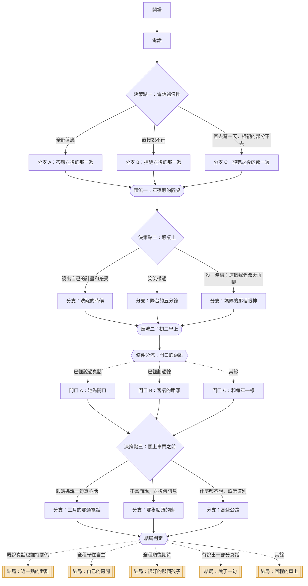

# 05｜《年夜飯前的那通電話》

> 親友期待與拒絕　・　主題：關係與自主
>
> 媽媽說「就三天而已」。你心裡算的不是三天，是那三天裡要被問幾次。

<!-- 這份文件由 tools/build-scripts.mjs 從 content/stories/story_05_before_the_reunion_dinner.json 產生，請勿手動編輯。 -->

| 項目 | 內容 |
|---|---|
| story_id | `story_05_before_the_reunion_dinner` |
| 版本 | 1.0.0（schema 1.0.0） |
| 對應島嶼 | 歸返島（`island_kin`） |
| 預估時間 | 約 3 分鐘 |
| 節點 / 決策點 / 選項 | 26 / 3 / 9 |
| 固定結局 / 航線 | 5 / 3 |
| 內容提醒 | 家庭關係、節慶壓力、被追問私事 |

## 場景與情緒衝突

- **地點**：電話的兩端：你的租屋處，和老家的廚房
- **時間**：除夕前一週，星期日晚上 20:40
- **衝突**：你愛她。她也愛你。這兩件事都沒有辦法讓那三天變得比較容易。

## 人物

| 角色 | 身分 | 設定 | 說話方式 |
|---|---|---|---|
| 你 | 在外地工作的子女 | 一個人住，離老家車程三小時。過年是一年裡唯一會待超過兩天的時候。 | 對外很好說話，對自己很會算 |
| 媽媽 | 母親 | 一個人張羅全家的年。她不是不講理，她是真的覺得自己在幫你。 | 講話會繞，重點放在最後，常用「就」字 |
| 佩玲 | 表姊 | 大你四歲，去年也被問過同樣的問題。在飯桌上通常坐在你旁邊。 | 低聲、快，像在傳紙條 |
| 舅舅 | 長輩 | 每年固定問三件事：工作、薪水、什麼時候。問完就笑著夾菜。 | 音量大，問句結尾會停住等你回答 |

## 狀態變數

航線判定只讀這些變數與選項標記，不讀其他任何東西。

| key | 名稱 | 初始值 | 說明 |
|---|---|---|---|
| `autonomy` | 自主 | 0 | 你為自己保留的決定權與空間 |
| `connect` | 靠近 | 0 | 你讓關係裡的人理解你的程度 |
| `comply` | 順從 | 0 | 你照著期待走的部分 |
| `honest` | 說真話 | 0 | 你把真實想法說出口的程度 |

## 流程圖

## 完整劇本

### 開場

`n_05_open`　・　旁白

*租屋處　・　星期日 20:40　・　放鬆到一半*

> 星期日晚上，你剛洗好一週的衣服，正在摺。
>
> **音效**（音效）：手機響。來電顯示：媽。
>
> 你把電話夾在肩膀和耳朵之間，手還在摺。

**前往**：`n_05_call`

### 電話

`n_05_call`　・　旁白

*電話中　・　星期日 20:41　・　從日常滑向重點*

> **媽媽**：吃飽沒？最近天氣變冷，你那個棉被有沒有換厚的。
>
> **你**：有啦。
>
> **媽媽**：喔對，過年你哪天回來？
>
> **你**：除夕那天早上吧，初三回。
>
> 電話那頭安靜了一秒。你知道那一秒是什麼。
>
> **媽媽**：⋯⋯那你能不能提早三天？阿嬤年紀大了，廚房我一個人弄不來。
>
> **媽媽**：就三天而已。
>
> **媽媽**：啊還有啊，陳阿姨她兒子今年也在家，人很好，在竹科。初二大家一起吃個飯，就吃個飯而已，你不要有壓力。
>
> 你手上的衣服摺到一半，停在那裡。
>
> **內心**（心聲）：三天，加上初二。還有舅舅一定會問的那三個問題。

**前往**：`n_05_d1`

### 決策點一：電話還沒掛

`n_05_d1`　・　決策點

*電話中　・　星期日 20:44　・　要回答了*

> 洗衣機在旁邊嗡嗡作響。她在等。

#### 選項：全部答應

`c_05_d1_yes`　・　副標：「一年一次，忍一下就過去了」

**立即反應**

> **你**：好啦，我請假。初二也可以。
>
> **媽媽**：真的喔？那我跟陳阿姨說囉！
>
> 她的聲音整個亮起來。那個亮度，是你最難拒絕的東西。
>
> 掛掉電話，你看著摺到一半的衣服，看了很久。

**實際後果**：你答應了六天和一頓飯，也換到了電話那頭的那個亮度。

**心聲線索「心聲線索」**（`clue_05_the_brightness`）

> 讓她高興這件事，對你是有價值的——這不是軟弱。只是值得分清楚：你是在給出去，還是在避免她失望？兩個聽起來很像，但後面那個會慢慢把人掏空。

**狀態影響**：順從 +2　|　**標記**：`comply`　|　**前往**：`n_05_a1`

#### 選項：直接說不行

`c_05_d1_no`　・　副標：「這次先把自己放前面」

**立即反應**

> **你**：媽，我沒辦法提早三天。假我要留著，而且初二那個飯我不去。
>
> 電話那頭安靜了。比剛剛那一秒長很多。
>
> **媽媽**：⋯⋯喔。好啦。那就除夕回來。
>
> **媽媽**：我自己弄就好了，我也是每年都這樣弄。
>
> 最後那句話，像一片很薄的刀。
>
> **內心**（心聲）：她不是故意的。但你確實被劃到了。

**實際後果**：你守住了自己的時間，也接住了一句聽起來很輕的重話。

**心聲線索「心聲線索」**（`clue_05_thin_blade`）

> 「我自己弄就好了」通常不是攻擊，是失望找不到地方放。但它確實會痛。你可以同時承認兩件事：她不是故意的，而你有權利覺得受傷。

**狀態影響**：自主 +2　|　**標記**：`autonomy`　|　**前往**：`n_05_b1`

#### 選項：回去幫一天，相親的部分不去

`c_05_d1_part`　・　副標：「分開處理這兩件事」

**立即反應**

> **你**：媽，這樣好不好——我提早一天回去，廚房那天我全程幫你。
>
> **你**：但初二那個飯我不去。不是因為那個人不好，是我現在不想用這種方式認識人。
>
> 你聽見她在那頭翻日曆的聲音。
>
> **媽媽**：⋯⋯一天夠嗎？那年糕要前一天蒸欸。
>
> **你**：那我那天早上六點就到。
>
> **媽媽**：六點？你不用啦，八點就好了。
>
> 話題從「你要不要回來」變成了「幾點到」。

**實際後果**：廚房的事談成了，相親的事你明確地推掉了，而且是用她聽得懂的方式。

**心聲線索「心聲線索」**（`clue_05_two_things`）

> 你把「幫忙」和「相親」拆成兩件事。這很重要——它們本來就是兩件事，只是常常被包成一個「孝順」的包裹一起遞過來。拆開之後，兩件都可以分別回答。

**狀態影響**：自主 +1、靠近 +1、說真話 +1　|　**標記**：`connect`　|　**前往**：`n_05_c1`

### 分支 A：答應之後的那一週

`n_05_a1`　・　旁白

*租屋處／公司　・　除夕前　・　慢慢被壓住*

> 你跟主管請了三天假，主管的表情停了一下，但還是准了。
>
> 媽媽傳來一張照片，是陳阿姨兒子的 LINE 大頭貼。
>
> **媽媽**（訊息）：人很體面吧
>
> 你回了一個貼圖。那是最省力的回答。

**前往**：`n_05_merge1`

### 分支 B：拒絕之後的那一週

`n_05_b1`　・　旁白

*租屋處　・　除夕前　・　懸著*

> 那一週，媽媽的訊息變少了。平常一天兩三則，現在一天一則。
>
> 她還是會傳天氣預報給你。但沒有再提廚房的事。
>
> **佩玲**（訊息）：欸 姑姑跟我媽說你今年不早回去
>
> **佩玲**（訊息）：沒事啦 我去年也被講 撐過初三就好

**前往**：`n_05_merge1`

### 分支 C：談完之後的那一週

`n_05_c1`　・　旁白

*租屋處　・　除夕前　・　還行*

> 媽媽傳了一張清單過來，手寫的，拍照上傳。
>
> **媽媽**（訊息）：這是那天要做的 你看一下
>
> 清單上有十一項，後面三項被劃掉了，旁邊寫著「這個今年不做了」。
>
> **內心**（心聲）：她自己減了三項。

**前往**：`n_05_merge1`

### 匯流一：年夜飯的圓桌

`n_05_merge1`　・　匯流　・　承接：`n_05_a1`、`n_05_b1`、`n_05_c1`

*老家客廳　・　除夕 18:30　・　熱、吵、菜很多*

> 除夕。十四個人，兩桌併成一桌，電視開著但沒有人在看。
>
> 佩玲坐在你旁邊，手肘碰了你一下，意思是：來了。
>
> **舅舅**：欸，你那個工作做幾年了？
>
> **你**：快三年。
>
> **舅舅**：三年喔。那現在一個月多少？
>
> 整桌的聲音好像小了一點。或者只是你的耳朵自己調了音量。
>
> **舅舅**：啊那⋯⋯有對象了沒？

**前往**：`n_05_d2`

### 決策點二：飯桌上

`n_05_d2`　・　決策點

*圓桌　・　除夕 18:47　・　十四個人在等*

> 媽媽在廚房門口，手上端著湯，也停下來了。

#### 選項：說出自己的計畫和感受

`c_05_d2_true`　・　副標：「讓他們知道真的版本」

**立即反應**

> **你**：舅舅，我跟你說我現在在幹嘛。
>
> **你**：我在做的案子明年會上線，我自己蠻想把它做完的。對象目前沒有，我也沒有在找。
>
> **你**：不過我想講一件事——每次回來被問這三個問題，我其實會有點累。不是你們不好，是我不知道怎麼回答才不會讓大家失望。
>
> 桌上安靜了兩秒。舅舅夾菜的手停在空中。
>
> **舅舅**：⋯⋯啊我就是問一下而已啊。
>
> **舅舅**：好啦好啦，吃菜吃菜。
>
> 佩玲在桌子底下踢了你一下。你低頭看，她在偷笑。

**實際後果**：你把真的版本放到桌上了，氣氛尷尬了兩秒，然後繼續吃飯。

**心聲線索「心聲線索」**（`clue_05_the_real_version`）

> 那兩秒的安靜，是整件事最貴的部分。但你注意到了嗎——兩秒之後，大家還是在吃飯。我們常常以為說真話會炸掉整個場子，實際上多半只是停兩秒。

**狀態影響**：說真話 +2、靠近 +1　|　**標記**：`honest`、`connect`　|　**前往**：`n_05_a2`

#### 選項：笑笑帶過

`c_05_d2_deflect`　・　副標：「過了這桌就好」

**立即反應**

> **你**：哈哈，就那樣啊，餓不死啦。
>
> **舅舅**：年輕人就是要拚啦！我跟你講我像你這個年紀的時候——
>
> 接下來八分鐘，舅舅講他年輕的時候。你點頭、笑、夾菜，一樣都沒有少。
>
> 佩玲在旁邊也笑，笑完之後很小聲地說了一句。
>
> **佩玲**：你笑的樣子跟我去年一模一樣。

**實際後果**：場面順利過去了，而你在那張桌子上消失了八分鐘。

**心聲線索「心聲線索」**（`clue_05_the_smile`）

> 笑著帶過是一種很熟練的技術，它保護了場面，也保護了你。代價是——那張桌子認識的，是一個你表演出來的版本。久了之後，連你自己都會覺得沒有人真的認識你。

**狀態影響**：順從 +2　|　**標記**：`comply`　|　**前往**：`n_05_b2`

#### 選項：設一條線：這個我們改天再聊

`c_05_d2_boundary`　・　副標：「不回答，也不翻臉」

**立即反應**

> **你**：舅舅，薪水跟感情這兩個我今天不聊喔。
>
> 你講的時候是笑著的，但講完就停住，沒有再補任何解釋。
>
> **舅舅**：欸？喔⋯⋯好啦。
>
> 三秒之後，他轉頭問旁邊的人今年廟裡的事。
>
> 媽媽把湯放上桌，看了你一眼。那個眼神你讀不出來。

**實際後果**：問題停了，沒有吵架，但房間裡多了一個大家都注意到的界線。

**心聲線索「心聲線索」**（`clue_05_no_explanation`）

> 你說完就停，沒有解釋——這是界線最難的部分。多補一句理由，就等於把決定權交回去讓對方評分。不解釋不是沒禮貌，是在說：這件事不需要被批准。

**狀態影響**：自主 +2　|　**標記**：`autonomy`　|　**前往**：`n_05_c2`

### 分支：洗碗的時候

`n_05_a2`　・　旁白

*廚房　・　除夕 20:30　・　水聲蓋住一切*

> 你在洗碗，媽媽在旁邊擦桌子。水聲很大。
>
> **媽媽**：你剛剛跟舅舅講那個⋯⋯
>
> **媽媽**：我不知道你每次回來都在想這個。
>
> 她沒有說對不起，也沒有說你講得對。她只是說她不知道。

**前往**：`n_05_merge2`

### 分支：陽台的五分鐘

`n_05_b2`　・　旁白

*陽台　・　除夕 20:30　・　出來透氣*

> 你端著一杯水站到陽台。外面有人在放鞭炮，很遠。
>
> 佩玲也出來了，靠在欄杆上。
>
> **佩玲**：我每年都站這裡。
>
> **佩玲**：你知道最煩的是什麼嗎？不是他們問。是我每次都笑得出來。

**前往**：`n_05_merge2`

### 分支：媽媽的那個眼神

`n_05_c2`　・　旁白

*客廳　・　除夕 20:30　・　有什麼沒有說*

> 飯後，媽媽在切水果。她切得比平常慢。
>
> **媽媽**：你剛剛那樣講⋯⋯舅舅不會怎樣啦。
>
> **媽媽**：他就是那樣。
>
> 她把切好的水果推到你面前，然後又推近了一點。

**前往**：`n_05_merge2`

### 匯流二：初三早上

`n_05_merge2`　・　匯流　・　承接：`n_05_a2`、`n_05_b2`、`n_05_c2`

*老家門口　・　初三 09:20　・　要走了*

> 初三早上，行李放進後車廂。媽媽從屋裡追出來，手上兩袋東西。
>
> **媽媽**：這個帶著，冰箱放得久。這個是阿嬤給的。
>
> 她把袋子放進去，站在車門旁邊，手在圍裙上擦了兩下。
>
> 這是每一年都會發生的畫面。也是每一年你都覺得還有一句話沒說的時刻。

**前往**：`n_05_door_check`

### 條件分流：門口的距離

`n_05_door_check`　・　條件分流

| 順序 | 條件 | 前往 | 說明 |
|---|---|---|---|
| 1 | 說真話 >= 2 | `n_05_g_known` | 已經說過真話 |
| 2 | 自主 >= 2 | `n_05_g_line` | 已經劃過線 |
| 保底 | 以上皆不成立 | `n_05_g_usual` | — |

### 門口 A：她先開口

`n_05_g_known`　・　旁白

*門口　・　初三 09:22　・　離得近一點*

> **媽媽**：那個⋯⋯明年如果你還是沒辦法早回來，就不要勉強。
>
> **媽媽**：我自己會想辦法。你打電話給我就好。
>
> 她講得很快，講完就去整理後車廂裡根本不需要整理的東西。

**前往**：`n_05_d3`

### 門口 B：客氣的距離

`n_05_g_line`　・　旁白

*門口　・　初三 09:22　・　有一點生疏*

> **媽媽**：開車小心。到了傳一下。
>
> 她退了半步，讓你關車門。
>
> 那半步很小。小到你不確定是不是自己想太多。

**前往**：`n_05_d3`

### 門口 C：和每年一樣

`n_05_g_usual`　・　旁白

*門口　・　初三 09:22　・　熟悉*

> **媽媽**：東西都帶了喔？錢夠不夠用？
>
> **媽媽**：你要記得吃飯啦。不要又只吃麵包。
>
> 一模一樣的三句話。從你搬出去的第一年開始，每一次都是這三句。

**前往**：`n_05_d3`

### 決策點三：關上車門之前

`n_05_d3`　・　決策點

*門口　・　初三 09:23　・　最後一個機會*

> 引擎已經發動了。她站在那裡。

#### 選項：跟媽媽說一句真心話

`c_05_d3_say`　・　副標：「一句就好，不用說完」

**立即反應**

> 你把窗戶搖下來。
>
> **你**：媽。
>
> **你**：我知道你是希望我過得好。我有在過得好，只是方式跟你想的不太一樣。
>
> 她愣住。然後用力點了兩下頭，轉過身去。
>
> **媽媽**：好啦好啦，快走快走，等一下塞車。
>
> 她的聲音有一點不穩。你知道她不會讓你看到那個。

**實際後果**：你說出口了。她沒有回應，但她聽見了。

**心聲線索「心聲線索」**（`clue_05_she_heard`）

> 她沒有說「我懂了」，她說的是「快走等一下塞車」。在很多家庭裡，這就是接收成功的訊號。不要用對方有沒有給出標準答案，來判斷這句話有沒有送到。

**狀態影響**：靠近 +2、說真話 +1　|　**標記**：`connect`、`honest`　|　**前往**：`n_05_a3`

#### 選項：不當面說，之後傳訊息

`c_05_d3_note`　・　副標：「用寫的比較說得出來」

**立即反應**

> 你揮揮手，把車開出巷口。
>
> 在高速公路的休息站，你停下來，打了一段很長的訊息，刪掉，重打。
>
> **你**（訊息）：媽，這次回去謝謝你。我知道你很累。我也知道你希望我過得好，我有在努力，只是方式可能跟你想的不一樣。路上很順，不用擔心。
>
> 送出。三分鐘後，已讀。然後是一個貼圖：一隻熊在點頭。

**實際後果**：話送到了，用的是一個你們兩個都比較不會慌的方式。

**心聲線索「心聲線索」**（`clue_05_the_message`）

> 用寫的不是逃避。面對面的時候，表情、語氣、對方的反應會同時衝過來，很多人會因此說不完整。選一個你講得完的方式，比選一個「正確」的方式有用。

**狀態影響**：靠近 +1、說真話 +1　|　**標記**：`connect`　|　**前往**：`n_05_b3`

#### 選項：什麼都不說，照常道別

`c_05_d3_quiet`　・　副標：「每年都是這樣，這樣也好」

**立即反應**

> **你**：好，那我走囉。到了跟你說。
>
> **媽媽**：好。
>
> 車子開出巷口，你從後照鏡看到她還站在那裡。
>
> 轉彎之後就看不到了。

**實際後果**：和每一年一樣。那句話又留到了明年。

**心聲線索「心聲線索」**（`clue_05_next_year`）

> 沒說出口不代表沒有發生。那句話還在你身上，它會在下一個除夕前一週、電話響起來的時候，再出現一次。這不是你的失敗——只是它還在等一個你覺得安全的時機。

**狀態影響**：順從 +1　|　**標記**：`comply`　|　**前往**：`n_05_c3`

### 分支：三月的那通電話

`n_05_a3`　・　旁白

*租屋處　・　三月　・　有東西不一樣了*

> 三月的某個晚上，媽媽打電話來。聊到一半，她突然說——
>
> **媽媽**：欸，你上次講那個『方式不一樣』，是什麼意思啊？
>
> 她想了兩個月。

**前往**：`n_05_ending_check`

### 分支：那隻點頭的熊

`n_05_b3`　・　旁白

*休息站　・　初三 11:40　・　鬆了一口氣*

> 你把手機放下，去買了一杯熱的。
>
> 回到車上，又看了一次那隻熊。
>
> **內心**（心聲）：她通常不用貼圖的。

**前往**：`n_05_ending_check`

### 分支：高速公路

`n_05_c3`　・　旁白

*高速公路　・　初三 10:30　・　空*

> 高速公路上車很多。你放了平常會聽的播客，但沒有在聽。
>
> 後車廂那兩袋東西，一直到下個禮拜你才整理。裡面有一包你小時候愛吃的糖，現在的你不太吃了。

**前往**：`n_05_ending_check`

### 結局判定

`n_05_ending_check`　・　條件分流

| 順序 | 條件 | 前往 | 說明 |
|---|---|---|---|
| 1 | 靠近 >= 3 且 說真話 >= 3 | `n_05_e_closer` | 既說真話也維持關係 |
| 2 | 自主 >= 4 | `n_05_e_room` | 全程守住自主 |
| 3 | 標記「comply」次數 >= 3 | `n_05_e_good` | 全程順從期待 |
| 4 | 說真話 >= 2 | `n_05_e_one_line` | 有說出一部分真話 |
| 保底 | 以上皆不成立 | `n_05_e_drive` | — |

## 結局

### 近一點的距離

`e_05_closer`　・　節點 `n_05_e_closer`　・　標籤：`autonomy`、`connect`

> 那年之後，電話的內容慢慢變了。她還是會問你吃飯沒，但也開始問你在做什麼案子。
>
> 她不一定聽得懂。她會說「喔，這樣喔」，然後問你那個很累嗎。
>
> 你發現，那句「這樣喔」比以前真心。

**結局回顧**：這一次，你守住了自己，也讓她更靠近了一點。

> 自主和親近不是互斥的。拒絕一件事不等於拒絕一個人——只是這個區別，常常需要被說出來，對方才分得清楚。

### 自己的房間

`e_05_room`　・　節點 `n_05_e_room`　・　標籤：`autonomy`

> 回到租屋處，你把兩袋東西放進冰箱，然後坐在地上。
>
> 房間很小，有一點亂，而且完全是你的。
>
> 你為此付出了一些代價。那些代價是真的，而這個房間也是真的。

**結局回顧**：這一次，你把自己的位置守住了。

> 守住界線通常要付出關係上的代價，這不是幻覺。只是另一件事也是真的：一個沒有自己位置的人，待在關係裡也會慢慢不見。

### 很好的那個孩子

`e_05_good`　・　節點 `n_05_e_good`　・　標籤：`comply`、`invisible_cost`

> 過年過得很順利。媽媽很開心，舅舅說你很懂事，陳阿姨那邊她也有交代過去。
>
> 回到租屋處那天晚上，你睡了十一個小時。
>
> 醒來的時候天已經黑了，你躺在那裡，不太想動。

**結局回顧**：這一次，你把所有人的期待都接住了。

> 你讓很多人開心了，這是真的。只是那幾天裡，沒有一個時刻是為你自己安排的——而這件事不會出現在任何人的感謝裡。

### 說了一句

`e_05_one_line`　・　節點 `n_05_e_one_line`　・　標籤：`honest`

> 你沒有把所有的話都說完。但你說了一句。
>
> 那一句不會改變什麼。下次舅舅還是會問，媽媽還是會希望你早點回去。
>
> 只是從今年開始，那張桌子上有一個版本的你，是真的。

**結局回顧**：這一次，你把一部分的自己放到桌上了。

> 不用一次說完。一句真話進到關係裡，它就會開始工作——通常比我們以為的慢，但它會。

### 回程的車上

`e_05_drive`　・　節點 `n_05_e_drive`　・　標籤：`mixed`

> 高速公路很長。你開著開著，想起後車廂那包糖。
>
> 她記得的是十年前的你。你沒有糾正她，也沒有辦法糾正。
>
> 下個交流道，你彎下去買了一杯熱的。

**結局回顧**：這一次，有些接住了，有些留著。

> 家人之間的事很少有結論。能在一年一次的那幾天裡，活著回來、而且還願意再回去，已經是一件不小的事。

## 結局判定

| 順序 | 條件 | 結局 |
|---|---|---|
| 1 | 靠近 >= 3 且 說真話 >= 3 | 結局：近一點的距離 |
| 2 | 自主 >= 4 | 結局：自己的房間 |
| 3 | 標記「comply」次數 >= 3 | 結局：很好的那個孩子 |
| 4 | 說真話 >= 2 | 結局：說了一句 |
| 保底 | 以上皆不成立 | 結局：回程的車上 |

## 三條航線

航線由固定規則判定，依 priority 由小到大評估，第一個命中的即為結果；最後一條是保底規則，
所以任何遊玩組合都會落在恰好一條航線上。AI 不參與這個判定。

### 1. 自主航線

`r_05_autonomy`

**敘事意涵**：明確地把決定權留在自己手上——直接拒絕、或在被追問時劃下不解釋的界線。重點是你沒有把自己的時間交出去審核。

**判定規則**：自主 >= 3 或 標記「autonomy」次數 >= 2

**航線解析（玩家看到的文案）**

> 你走的是「自主航線」。
>
> 你把「不」說出口了，而且沒有為它附上一長串理由。
>
> 不解釋是最難的部分，因為我們從小學到的是：拒絕要配一個好理由，不然就是不孝、不乖、不好相處。這條航線的代價通常落在關係的溫度上，而你選擇先接住自己。

**情緒練習卡**：《我的那一份》先弄清楚自己要什麼，再決定給多少（`pc_05_autonomy`，約 3 分鐘）

**島嶼地景**：自己的房間　——　主屋旁邊多了一間小屋，門是朝外開的。

> 主屋旁邊多了一間小屋。它很小，但門朝外開，而且鑰匙在你手上。

新增地塊 1 個、新增物件 1 個。

### 2. 靠近航線

`r_05_connect`

**敘事意涵**：在關係裡協商或說真話——拆開請求、說出感受、或事後把話補上。重點是你讓對方有機會認識真實的你。

**判定規則**：標記「connect」次數 >= 1 或 靠近 >= 2

**航線解析（玩家看到的文案）**

> 你走的是「靠近航線」。
>
> 你沒有把門關上，也沒有整個讓出去。你把一部分真實的自己，放進了這段關係裡。
>
> 這條路比較慢，而且需要對方也願意走幾步。它的好處是：被認識的那個人，是真的你。

**情緒練習卡**：《說一句真的》不用說完，說一句就好（`pc_05_connect`，約 3 分鐘）

**島嶼地景**：回家的路　——　一條從碼頭通到屋子的路。走得進來，也走得出去。

> 碼頭和屋子之間鋪出一條路。它是雙向的——走得進來，也走得出去。

新增地塊 1 個、新增物件 2 個。

### 3. 順應航線

`r_05_comply`

**敘事意涵**：保底航線。以答應、帶過、不說為主的所有組合。不代表錯，代表這一次你選擇讓關係先順利運轉。

**判定規則**：永遠成立（保底）

**航線解析（玩家看到的文案）**

> 你走的是「順應航線」。
>
> 你讓那幾天順利過去了。沒有人不開心，沒有人被為難，而這需要很強的能力——讀空氣、接話、把自己收得剛剛好。
>
> 只是這幾天裡，沒有一個時刻是替你自己安排的。這件事不會出現在任何人的感謝裡，所以得由你自己記得。

**情緒練習卡**：《答應之後，留一格給自己》你還是可以在裡面安排一小塊時間（`pc_05_comply`，約 2 分鐘）

**島嶼地景**：長桌　——　院子裡擺了一張很長的桌子，位置夠坐下所有人。

> 院子裡擺了一張長桌，位置夠所有人坐。包括你的那一個。

新增地塊 1 個、新增物件 2 個。

## 重新遊玩可以探索的

- 第一通電話如果拆開回答，媽媽傳來的那張清單會有不一樣的內容。
- 飯桌上說真話，舅舅的反應可能跟你預期的不同——他夾菜的手會停在空中。
- 門口那一幕有三個版本，取決於這幾天裡你有沒有說過真話、或劃過線。
- 這篇故事有五個固定結局與三條航線，其中「近一點的距離」需要你同時守住自己、也讓對方靠近。

