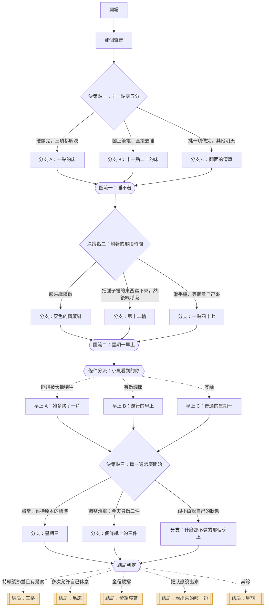

# 06｜《週日晚上十一點》

> 明明疲累卻無法休息　・　主題：自我要求與休息焦慮
>
> 你很累。清單上還有三項。這兩件事在你身上同時成立，而且互不相讓。

<!-- 這份文件由 tools/build-scripts.mjs 從 content/stories/story_06_sunday_eleven_pm.json 產生，請勿手動編輯。 -->

| 項目 | 內容 |
|---|---|
| story_id | `story_06_sunday_eleven_pm` |
| 版本 | 1.0.0（schema 1.0.0） |
| 對應島嶼 | 歇腳島（`island_rest`） |
| 預估時間 | 約 3 分鐘 |
| 節點 / 決策點 / 選項 | 26 / 3 / 9 |
| 固定結局 / 航線 | 5 / 3 |
| 內容提醒 | 過勞、睡眠困難、自我要求 |

## 場景與情緒衝突

- **地點**：租屋處的客廳，一盞立燈，筆電在腿上，旁邊是攤開的待辦清單
- **時間**：星期日晚上 23:02
- **衝突**：沒有人在逼你。這就是最難的地方——那個聲音住在裡面，它不會下班。

## 人物

| 角色 | 身分 | 設定 | 說話方式 |
|---|---|---|---|
| 你 | —— | 這陣子每天都覺得沒做完，但說不出來到底還差什麼。 | 對別人很寬，對自己很嚴 |
| 小魚 | 室友 | 作息很規律，十一點半一定刷牙。偶爾會從房間探頭出來說一句很準的話。 | 散漫、短句、不逼人 |
| 那個聲音 | 你腦中的聲音 | 它用的是你的語氣，講的是「應該」。它不是壞人，它只是從來不休息。 | 冷靜、合理、永遠都有下一句 |

## 狀態變數

航線判定只讀這些變數與選項標記，不讀其他任何東西。

| key | 名稱 | 初始值 | 說明 |
|---|---|---|---|
| `rest` | 允許休息 | 0 | 你讓自己停下來的程度 |
| `adjust` | 調節 | 0 | 你調整標準與分量的程度 |
| `burn` | 硬撐 | 0 | 你用意志力往前推的部分 |
| `aware` | 覺察 | 0 | 你看見自己的狀態、或讓別人看見的程度 |

## 流程圖

## 完整劇本

### 開場

`n_06_open`　・　旁白

*客廳　・　星期日 23:02　・　累到一個程度之後的平靜*

> 星期日晚上十一點零二分。立燈是暖黃色的，筆電放在腿上，已經燙了。
>
> 清單上十一項，打勾了八項。剩下三項：回那封信、整理下週簡報、繳帳單。
>
> 你的眼睛乾到要眨兩次才對焦得起來。肩膀往上縮，你自己沒有發現。

**前往**：`n_06_voice`

### 那個聲音

`n_06_voice`　・　旁白

*客廳　・　星期日 23:05　・　被追著*

> **那個聲音**（心聲）：再三十分鐘就做完了。
>
> **那個聲音**（心聲）：現在睡，明天早上還是要做，而且會更趕。
>
> 它講得很有道理。它一向很有道理。
>
> 你看了一下時間，又看了一下清單。那三項，每一項都沒有很大。
>
> **那個聲音**（心聲）：而且你今天也沒做多少啊。
>
> 這句話讓你停了一下。你今天從早上九點做到現在。

**前往**：`n_06_d1`

### 決策點一：十一點零五分

`n_06_d1`　・　決策點

*客廳　・　星期日 23:05　・　身體和清單在拉扯*

> 小魚房間的燈剛剛熄了。整個屋子只剩你這一盞。

#### 選項：硬做完，三項都解決

`c_06_d1_push`　・　副標：「做完才能真正放鬆」

**立即反應**

> 你把筆電往上挪了一點，開始回那封信。
>
> 回完信是十一點四十。簡報整理到一半，你發現自己讀同一行讀了三次。
>
> 凌晨十二點五十，三項都打勾了。你看著那十一個勾。
>
> **那個聲音**（心聲）：看吧，做得完。
>
> 但你沒有覺得輕鬆。你只是覺得⋯⋯空的。

**實際後果**：三項都完成了，花掉的是一小時四十五分鐘的睡眠。

**心聲線索「心聲線索」**（`clue_06_all_ticked`）

> 全部打勾之後沒有變輕鬆，這件事值得注意。如果完成帶不來放鬆，那追的可能不是「做完」，而是「做完才可以存在」——那是一個永遠達不到的條件。

**狀態影響**：硬撐 +2、允許休息 -1　|　**標記**：`burn`　|　**前往**：`n_06_a1`

#### 選項：闔上筆電，直接去睡

`c_06_d1_sleep`　・　副標：「今天到這裡」

**立即反應**

> 你把筆電闔上。那個「喀」的聲音比你想像中大。
>
> **那個聲音**（心聲）：⋯⋯真的要這樣？
>
> 你沒有回答它。你去刷牙，水龍頭的聲音蓋過一部分。
>
> 十一點二十躺上床。比平常早四十分鐘。

**實際後果**：你把今晚還給自己了，三項留到明天。

**心聲線索「心聲線索」**（`clue_06_the_click`）

> 闔上筆電那個動作，是你對那個聲音說「今天到這裡」。你沒有說服它——你不需要說服它。有時候停下來不需要理由充分，只需要你真的停。

**狀態影響**：允許休息 +2　|　**標記**：`rest`　|　**前往**：`n_06_b1`

#### 選項：挑一項做完，其他明天

`c_06_d1_one`　・　副標：「不是全部，也不是零」

**立即反應**

> 你看了三項，選了最快的那個：繳帳單。四分鐘。
>
> 然後你拿起筆，在另外兩項旁邊寫上「一」和「二」，還有大概要花多久。
>
> **那個聲音**（心聲）：那還有兩項欸。
>
> **你**：我知道。明天早上九點到十點。
>
> 你把清單翻面蓋住，闔上筆電。十一點二十五。

**實際後果**：一項完成，兩項有了明確的時間，今晚結束了。

**心聲線索「心聲線索」**（`clue_06_named_the_time`）

> 你給剩下的事情一個時間，所以它們不用一直待在腦子裡提醒你。未完成的事之所以讓人睡不著，常常不是因為它難，是因為它沒有落腳的地方。

**狀態影響**：調節 +2、允許休息 +1　|　**標記**：`adjust`　|　**前往**：`n_06_c1`

### 分支 A：一點的床

`n_06_a1`　・　旁白

*房間　・　凌晨 01:00　・　過載*

> 躺下來，身體很重，但腦子轉得很快。簡報第四頁的排版突然跳出來。
>
> 你翻身。手機在床頭亮了一下，是明天的鬧鐘提醒：六點五十。

**前往**：`n_06_merge1`

### 分支 B：十一點二十的床

`n_06_b1`　・　旁白

*房間　・　星期日 23:20　・　身體躺下了*

> 躺下來。天花板有一道從窗簾縫透進來的光。
>
> 身體很放鬆。腦子⋯⋯還沒接收到這個消息。
>
> **那個聲音**（心聲）：那封信明天不回，對方會不會覺得你很不積極？

**前往**：`n_06_merge1`

### 分支 C：翻面的清單

`n_06_c1`　・　旁白

*房間　・　星期日 23:30　・　有一點踏實*

> 躺下來。你想起清單被你翻面蓋著，在客廳桌上。
>
> 明天九點到十點。你又在心裡確認了一次，然後把它放下。
>
> **那個聲音**（心聲）：⋯⋯那簡報如果九點做不完呢。

**前往**：`n_06_merge1`

### 匯流一：睡不著

`n_06_merge1`　・　匯流　・　承接：`n_06_a1`、`n_06_b1`、`n_06_c1`

*房間　・　深夜　・　清醒得很煩*

> 不管你幾點躺下，有一件事一樣：你睡不著。
>
> 身體明明累到骨頭裡，腦子卻在跑明天的行程、下週的事、還有一件你三個月前沒處理好的。
>
> **那個聲音**（心聲）：你看，躺著也是浪費時間。

**條件式對白**　若：標記「burn」次數 >= 1

> 時鐘顯示 01:18。再五個半小時鬧鐘就會響。

**條件式對白**　若：標記「rest」次數 >= 1

> 時鐘顯示 23:52。你提早躺下，結果躺著更清醒，這讓你有一點生氣。

**條件式對白**　若：標記「adjust」次數 >= 1

> 時鐘顯示 00:04。你知道明天的安排，但身體還是沒有接收到可以下班的訊號。

**前往**：`n_06_d2`

### 決策點二：躺著的那段時間

`n_06_d2`　・　決策點

*房間　・　深夜　・　醒著，而且知道自己醒著*

> 手機在床頭，離你的手二十公分。筆電在客廳。

#### 選項：起來繼續做

`c_06_d2_up`　・　副標：「既然睡不著，不如做點事」

**立即反應**

> 你掀開棉被，走回客廳。立燈又亮起來。
>
> 一開始很順。做了五十分鐘，你發現自己在同一張投影片上改了又改，改回原來的版本。
>
> **那個聲音**（心聲）：再一下就好。
>
> 再一下是四十分鐘。回到床上的時候，窗簾那道縫已經有一點灰。

**實際後果**：你多做了一個半小時，品質你自己也不太確定，睡眠再少一截。

**心聲線索「心聲線索」**（`clue_06_one_more`）

> 「再一下就好」是個沒有終點的句子，因為「好」的標準會隨著時間往上移。注意一件事：你後來改的東西，最後改回了原來的版本——那不是在工作，是焦慮在找事情做。

**狀態影響**：硬撐 +2、允許休息 -1　|　**標記**：`burn`　|　**前往**：`n_06_a2`

#### 選項：把腦子裡的東西寫下來，然後練呼吸

`c_06_d2_write`　・　副標：「讓它們有地方放」

**立即反應**

> 你開了床頭的小燈，拿紙筆——不是手機。
>
> 把腦子裡跑的東西一條一條寫下來，寫了七條。其中兩條寫出來才發現根本不是明天的事。
>
> 然後你躺平，手放在肚子上。吸氣四秒、停兩秒、吐氣六秒。
>
> 第五輪的時候，你發現自己的下巴一直咬著。你讓它鬆開。
>
> **那個聲音**（心聲）：⋯⋯
>
> 那個聲音沒有消失。但它變小聲了。

**實際後果**：七件事落到紙上，身體慢慢退出警戒狀態。

**心聲線索「心聲線索」**（`clue_06_on_paper`）

> 腦子會一直複誦那些還沒有落腳的事，因為它怕你忘記。寫下來等於跟它說：我記下來了，你可以不用再提醒我。吐氣比吸氣長，是在告訴身體：現在沒有危險。

**狀態影響**：調節 +2、覺察 +1　|　**標記**：`adjust`、`aware`　|　**前往**：`n_06_b2`

#### 選項：滑手機，等睏意自己來

`c_06_d2_scroll`　・　副標：「放空一下」

**立即反應**

> 你拿起手機。一開始是看影片，然後是別人的動態。
>
> 有人換了工作，有人出國，有人半夜在健身房。
>
> **那個聲音**（心聲）：你看他們。
>
> 你放下手機的時候是一點四十七分。你不太記得剛剛看了什麼，但心情比拿起來之前更差一點。

**實際後果**：時間過去了，身體還是沒有休息到，而且多了一點比較。

**心聲線索「心聲線索」**（`clue_06_the_scroll`）

> 滑手機看起來像休息，但身體沒有收到放鬆的訊號——螢幕的光和不斷切換的畫面，都讓神經系統繼續待命。它比較像是把注意力暫時搬走，而不是讓自己停下來。這沒有不對，只是值得知道它不等於休息。

**狀態影響**：硬撐 +1　|　**標記**：`numb`　|　**前往**：`n_06_c2`

### 分支：灰色的窗簾縫

`n_06_a2`　・　旁白

*房間　・　凌晨 03:10　・　過了那個點*

> 你躺回床上，身體有一種奇怪的輕，那不是休息的輕，是撐太久的那種。
>
> 鬧鐘在三個多小時後。你把眼睛閉上，努力不要去算還剩幾小時。

**前往**：`n_06_merge2`

### 分支：第十二輪

`n_06_b2`　・　旁白

*房間　・　深夜　・　慢慢下沉*

> 你數到第十二輪，然後就不記得了。
>
> 紙上那七條字，早上起來看的時候，有四條你覺得「這個其實不用急」。

**前往**：`n_06_merge2`

### 分支：一點四十七

`n_06_c2`　・　旁白

*房間　・　凌晨 01:47　・　更空了*

> 手機放下之後，房間變得很暗，你的眼睛一時適應不過來。
>
> 睏意終於來了，在兩點多。那是一種被耗完的睏，不是舒服的那種。

**前往**：`n_06_merge2`

### 匯流二：星期一早上

`n_06_merge2`　・　匯流　・　承接：`n_06_a2`、`n_06_b2`、`n_06_c2`

*廚房　・　星期一 07:20　・　新的一週*

> 星期一早上七點二十。小魚已經在廚房，正在烤吐司。
>
> **小魚**：早。
>
> 她看了你一眼，轉身把另一片吐司也放進去。

**前往**：`n_06_morning_check`

### 條件分流：小魚看到的你

`n_06_morning_check`　・　條件分流

| 順序 | 條件 | 前往 | 說明 |
|---|---|---|---|
| 1 | 允許休息 <= -1 | `n_06_m_worn` | 睡眠被大量犧牲 |
| 2 | 調節 >= 2 | `n_06_m_steady` | 有做調節 |
| 保底 | 以上皆不成立 | `n_06_m_plain` | — |

### 早上 A：她多烤了一片

`n_06_m_worn`　・　旁白

*廚房　・　星期一 07:22　・　被看出來了*

> **小魚**：你昨天幾點睡？
>
> **你**：⋯⋯還好啊。
>
> **小魚**：我半夜起來上廁所，客廳的燈是亮的。
>
> 她把奶油推過來，沒有再問。

**前往**：`n_06_d3`

### 早上 B：還行的早上

`n_06_m_steady`　・　旁白

*廚房　・　星期一 07:22　・　不特別好，但不差*

> **小魚**：你昨天好像比較早關燈。
>
> **你**：嗯，有剩兩項沒做完，排到今天早上。
>
> **小魚**：喔。那很厲害欸。
>
> 你抬頭。你本來以為她要說的是「怎麼沒做完」。

**前往**：`n_06_d3`

### 早上 C：普通的星期一

`n_06_m_plain`　・　旁白

*廚房　・　星期一 07:22　・　照常*

> 吐司跳起來。小魚把其中一片放到你面前的盤子上。
>
> **小魚**：這禮拜你很忙喔？
>
> 你拿起吐司，咬了一口，還在想要怎麼回答。

**前往**：`n_06_d3`

### 決策點三：這一週怎麼開始

`n_06_d3`　・　決策點

*廚房　・　星期一 07:25　・　可以重新設定*

> 你的手機在桌上，日曆這週已經排滿。清單在客廳，還攤著。

#### 選項：照常，維持原本的標準

`c_06_d3_same`　・　副標：「現在放鬆就會垮掉」

**立即反應**

> 你把這週的事全部排進日曆，一格接一格，中間沒有空白。
>
> **那個聲音**（心聲）：這樣才對。
>
> 星期三的時候你會發現自己排太滿。但那是星期三的事。

**實際後果**：這一週用跟上週一樣的方式開始，也會用一樣的方式結束。

**心聲線索「心聲線索」**（`clue_06_same_again`）

> 維持高標準讓人有控制感，而在一切都很失控的時候，控制感是很珍貴的東西。只是值得問一句：這個標準是你選的，還是你不敢放下的？兩種聽起來一樣，撐下去的感覺完全不同。

**狀態影響**：硬撐 +2　|　**標記**：`burn`　|　**前往**：`n_06_a3`

#### 選項：調整清單：今天只做三件

`c_06_d3_list`　・　副標：「把全部換成三件」

**立即反應**

> 你拿了一張便條紙，從清單裡挑三件寫上去。
>
> 原本那張清單，你把它收進抽屜——不是丟掉，是收起來。
>
> **那個聲音**（心聲）：那其他的呢？
>
> **你**：其他的在抽屜裡。今天的在這裡。
>
> 便條紙很小，小到你今天不用再去評估自己有沒有落後。

**實際後果**：你把「全部」換成了「今天的三件」，而且有機會真的完成。

**心聲線索「心聲線索」**（`clue_06_three_items`）

> 待辦清單會無限長，但一天的體力是固定的。當清單永遠做不完，「今天完成了」這件事就永遠不會發生——而人需要那個完成感才有辦法繼續。三件不是降低標準，是讓完成變成可能。

**狀態影響**：調節 +2、允許休息 +1　|　**標記**：`adjust`　|　**前往**：`n_06_b3`

#### 選項：跟小魚說自己的狀態

`c_06_d3_tell`　・　副標：「讓一個人知道」

**立即反應**

> **你**：我最近有點怪。
>
> **你**：明明很累，但是停不下來。停下來會很焦慮，好像不做完就不行。
>
> 小魚咬了一口吐司，想了一下。
>
> **小魚**：我大學的時候也這樣。
>
> **小魚**：後來我發現，我不是在做事，我是在躲一種感覺。只要手一停，那個感覺就會上來。
>
> **小魚**：你要不要⋯⋯今天晚上試試看什麼都不做，看看會怎樣。
>
> 她說完就去洗盤子了，好像剛剛那段話沒有什麼大不了。

**實際後果**：有一個人知道了，而且她給了你一個你自己想不到的角度。

**心聲線索「心聲線索」**（`clue_06_hiding_from`）

> 「手一停，那個感覺就會上來」——如果這句話對你有感覺，那它可能比「時間管理」更接近問題的核心。停不下來有時候不是因為事情太多，是因為停下來之後要面對的東西太難。這不是意志力的問題。

**狀態影響**：覺察 +2、允許休息 +1　|　**標記**：`aware`　|　**前往**：`n_06_c3`

### 分支：星期三

`n_06_a3`　・　旁白

*公司　・　星期三 15:00　・　一樣的循環*

> 星期三下午三點，你在會議中想不起來一個很常用的字。
>
> 你笑著說「啊我今天腦袋不太行」，大家也笑了。
>
> 晚上回到家，清單上又是十一項。

**前往**：`n_06_ending_check`

### 分支：便條紙上的三件

`n_06_b3`　・　旁白

*家　・　星期一 21:00　・　完成了*

> 晚上九點，三件都打勾了。便條紙上沒有第四件。
>
> 你坐在沙發上，有一種很久沒有出現的感覺：今天可以了。
>
> **那個聲音**（心聲）：⋯⋯那抽屜裡那張呢。
>
> **你**：明天再拿出來。

**前往**：`n_06_ending_check`

### 分支：什麼都不做的那個晚上

`n_06_c3`　・　旁白

*家　・　星期一 20:30　・　不舒服，然後慢慢可以*

> 晚上你試了。什麼都不做，坐在那裡。
>
> 前十分鐘非常不舒服，手一直想去拿手機，心跳有點快。
>
> 第十五分鐘左右，那個不舒服慢慢降下來了。你還是沒有做任何事。
>
> 小魚從房間經過，看到你，什麼都沒說，比了一個大拇指。

**前往**：`n_06_ending_check`

### 結局判定

`n_06_ending_check`　・　條件分流

| 順序 | 條件 | 前往 | 說明 |
|---|---|---|---|
| 1 | 調節 >= 4 且 覺察 >= 1 | `n_06_e_three` | 持續調節並且有覺察 |
| 2 | 允許休息 >= 3 | `n_06_e_hammock` | 多次允許自己休息 |
| 3 | 標記「burn」次數 >= 2 且 允許休息 <= -1 | `n_06_e_still_on` | 全程硬撐 |
| 4 | 覺察 >= 2 | `n_06_e_said` | 把狀態說出來 |
| 保底 | 以上皆不成立 | `n_06_e_monday` | — |

## 結局

### 三格

`e_06_three`　・　節點 `n_06_e_three`　・　標籤：`adjust`

> 後來你每天早上寫三件。有些天只完成兩件，有些天多做了一件。
>
> 抽屜裡那張長清單還在，每個禮拜拿出來看一次，劃掉一些、加上一些。
>
> 它沒有變短。但它不再躺在你的胸口上。

**結局回顧**：這一次，你把「全部」換成了「今天的份」。

> 一天的體力是固定的，清單卻可以無限長。當完成永遠不會發生，人就會一直欠自己的。三件不是降標準，是讓「今天可以了」有機會成真。

### 吊床

`e_06_hammock`　・　節點 `n_06_e_hammock`　・　標籤：`rest`

> 那個禮拜你睡得比上個月都好。事情沒有少，但你開始在做完之前就停。
>
> 有一天晚上，你在沙發上睡著了，醒來發現小魚幫你蓋了一件外套。
>
> 那個聲音還在。只是你現在知道，可以不用每次都聽它的。

**結局回顧**：這一次，你讓自己停下來了。

> 休息不是做完事情的獎賞，是下一天的材料。這個順序如果顛倒，人會一直在透支——而透支不會因為你很努力就免除利息。

### 燈還亮著

`e_06_still_on`　・　節點 `n_06_e_still_on`　・　標籤：`burn`、`invisible_cost`

> 這一週你全部做完了。下一週的清單也排好了，一格接一格。
>
> 星期五晚上，你坐在客廳，立燈還亮著。你很想休息，但不知道要做什麼才叫休息。
>
> 你打開筆電。螢幕的光比立燈亮。

**結局回顧**：這一次，你用意志力把它推完了。

> 你的執行力是真的，沒有人能否認。只是有一件事值得留意：如果完成之後沒有變輕鬆，那追的可能不是「做完」。那個東西不會因為做得更多而消失。

### 說出來的那一句

`e_06_said`　・　節點 `n_06_e_said`　・　標籤：`aware`

> 「我不是在做事，我是在躲一種感覺。」
>
> 小魚那天早上隨口說的話，你想了一整個禮拜。
>
> 你還沒有找到答案。但你開始注意：是哪一刻、手停下來的時候，那個東西會上來。

**結局回顧**：這一次，你把自己的狀態說出口了。

> 停不下來有時候不是時間管理的問題，是停下來之後要面對的東西太難。這不需要你馬上解決——先能看見它在那裡，就已經不一樣了。

### 星期一

`e_06_monday`　・　節點 `n_06_e_monday`　・　標籤：`mixed`

> 星期一過完了。有些事做了，有些事還在。
>
> 晚上你躺下的時候，想起昨天那三項其實也沒有那麼重要。
>
> 這個念頭讓你有點生氣，又有點鬆。

**結局回顧**：這一次，你在撐著和放下之間來回了一下。

> 大部分人的狀態都是這樣來回的，很少有人一次就切換過去。來回本身不是失敗，它是在找新的平衡點。

## 結局判定

| 順序 | 條件 | 結局 |
|---|---|---|
| 1 | 調節 >= 4 且 覺察 >= 1 | 結局：三格 |
| 2 | 允許休息 >= 3 | 結局：吊床 |
| 3 | 標記「burn」次數 >= 2 且 允許休息 <= -1 | 結局：燈還亮著 |
| 4 | 覺察 >= 2 | 結局：說出來的那一句 |
| 保底 | 以上皆不成立 | 結局：星期一 |

## 三條航線

航線由固定規則判定，依 priority 由小到大評估，第一個命中的即為結果；最後一條是保底規則，
所以任何遊玩組合都會落在恰好一條航線上。AI 不參與這個判定。

### 1. 允許休息航線

`r_06_allow`

**敘事意涵**：在事情還沒做完的狀態下，讓自己停下來。重點是「允許」——不是因為做完了才休息，而是因為需要。

**判定規則**：允許休息 >= 3 或 標記「rest」次數 >= 1

**航線解析（玩家看到的文案）**

> 你走的是「允許休息航線」。
>
> 你在事情還沒做完的時候闔上了筆電。對很多人來說，這比做完更難——因為那個聲音會立刻開始算帳。
>
> 你沒有說服它，你只是停了。有時候這就夠了。

**情緒練習卡**：《准許單》休息不需要先做完所有事（`pc_06_allow`，約 1 分鐘）

**島嶼地景**：樹蔭與吊床　——　兩棵樹之間掛起一張吊床。它什麼功能都沒有。

> 兩棵樹之間掛起一張吊床。它不生產任何東西，這就是它的用途。

新增地塊 1 個、新增物件 1 個。

### 2. 調節航線

`r_06_adjust`

**敘事意涵**：不是全做也不是不做，而是調整分量、排定時間、或把腦中的東西放到紙上。重點是讓事情有落腳的地方。

**判定規則**：標記「adjust」次數 >= 1 或 調節 >= 2

**航線解析（玩家看到的文案）**

> 你走的是「調節航線」。
>
> 你沒有跟那個聲音硬碰硬，而是換了一個做法：給事情一個時間、一個位置、一個今天的份量。
>
> 未完成之所以讓人睡不著，常常不是因為它難，是因為它沒有落腳的地方。你幫它找了一個。

**情緒練習卡**：《三格清單》把「全部」換成「今天的三件」（`pc_06_adjust`，約 2 分鐘）

**島嶼地景**：三塊田　——　島上整出三小塊田，不多不少，剛好三塊。

> 島上整出三小塊田。不是全部開墾，就三塊——這是今天的份。

新增地塊 1 個、新增物件 3 個。

### 3. 燃燒航線

`r_06_burn`

**敘事意涵**：保底航線。以硬做、起來繼續、維持原標準為主的所有組合。不代表錯，代表這一次你用意志力把它推過去了。

**判定規則**：永遠成立（保底）

**航線解析（玩家看到的文案）**

> 你走的是「燃燒航線」。
>
> 你把事情推完了，而且推得很確實。你的執行力不是假的。
>
> 只是這條航線用的是存量——睡眠、專注力、對自己的耐心。它們會補回來，但不會自動補，而且補的速度比用掉的慢。

**情緒練習卡**：《停損點》既然要做，至少先定一個停的時間（`pc_06_burn`，約 1 分鐘）

**島嶼地景**：不滅的燈　——　一盞整夜亮著的燈，旁邊放著一個計時的沙漏。

> 島上亮起一盞整夜不滅的燈，旁邊放著一個沙漏。燈會亮，但沙會流完。

新增地塊 1 個、新增物件 1 個。

## 重新遊玩可以探索的

- 十一點那個決定，會改變你半夜躺在床上時看到的時鐘數字。
- 「那個聲音」在每個分支說的話都不一樣——在某一條路上，它會安靜下來。
- 小魚在星期一早上說的話有三個版本，她會先看你的臉。
- 這篇故事有五個固定結局與三條航線，其中「三格」需要你連續兩次選擇調整，而不是硬撐或完全放掉。

